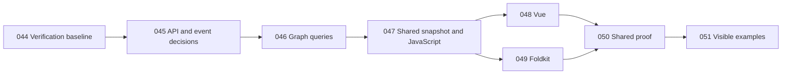

# Implementation plans

## Definitive project goal

As clarified by the maintainer on 2026-09-26, Flow aims to match React Flow's public interfaces as closely as each supported framework permits, and to make every example, UI component, and template in the React Flow catalogs achievable in every supported framework. Plain JavaScript, Vue, and Foldkit share this destination; future supported adapters inherit it.

The scope is defined by all entries in the [API reference sidebar](https://reactflow.dev/api-reference), [examples catalog](https://reactflow.dev/examples), and [UI sidebar](https://reactflow.dev/ui). These three catalogs are the definitive product target. Match public names, options, data shapes, events, and observable behavior wherever practical. Express hooks, providers, rendering, reactivity, and lifecycle through each framework's native conventions, with explicit mappings and reasons for differences.

Every catalog capability belongs on the roadmap, including advanced examples and templates. A capability may be delivered through shared core logic, an adapter, reusable UI, or an example integration. Capability gaps remain open until demonstrated in each supported framework. Existing bounded adapter milestones describe current progress; they do not limit the final goal. Parity claims still require reference evidence, and current architecture differences must be reviewed against the goal rather than assumed permanent.

[Plan 043](043-establish-definitive-react-flow-parity-goal.md) carried this decision into the project overview and authoritative progress checklist at `9a583d7`; catalog discovery followed at `1aa5915`. Its full verification acceptance remains blocked by the baseline failures assigned to Plan 044. The next selected chunk is Plans 044-051 below. Earlier deferrals of full adapter parity below are historical sequencing decisions. Their local completion boundaries remain valid.

## Planning history

Plan 001 was written against the original unborn `main` and is complete at `e393e3e`. Plans 002-010 were written with the improve skill on 2026-09-23 against that commit after a standard audit; the user selected all nine vetted findings. Read each plan fully, run its drift check and STOP conditions, and update its status row after the complete verification gate passes. Preserve unrelated work. Do not commit, push, or open a PR without operator instruction. Plan 011 was added on 2026-09-23 against `5274aef` and is complete. Plans 012-021 were written against `6e84008` as the next ten bounded scopes from `research/PROGRESS.md` and the Plan 011 baseline. The former handoff is a dated snapshot in `docs/archive/`; current status lives in `research/PROGRESS.md`. Later plans must re-read the contracts produced by earlier plans before executing; their drift checks and STOP conditions make that dependency explicit.

Plans 022-029 were written on 2026-09-24 against `5e5d496` using the open items in `research/PROGRESS.md`. They form one interaction and canvas UI chunk: reference boundaries, deterministic browser proof, multi-direction resize, gesture cancellation, custom drag handles, panel placement, and focused verification. They do not promise full xyflow or framework-adapter parity. Plan 029's keyboard proof exposed a native renderer-control activation defect; Plan 032 fixed native key ownership before Plan 029's proof resumed. The advisor checkout had uncommitted documentation changes when these plans were written; each executor must inspect live status and preserve them.

## Execution order and status

| Plan | Title | Priority | Effort | Depends on | Status |
| --- | --- | --- | --- | --- | --- |
| [001](001-stabilize-graph-and-rendering-contracts.md) | Stabilize the graph document and extensible rendering contracts | P1 | L | none | DONE — `bun run verify` passed in the isolated worktree |
| [002](002-reposition-descendants-on-update.md) | Reposition descendants after an authoritative parent update | P1 | S | 001 | DONE — `0f4fef2`, reviewed; verify passed |
| [003](003-render-graph-stacking-order.md) | Render nodes in the graph's stacking order | P1 | S | 002 | DONE — `090aeb1`, reviewed; verify passed |
| [004](004-cancel-invalid-group-drag.md) | Cancel a group drag when any participant becomes invalid | P1 | S | 002 | DONE — `7e31770`, reviewed; verify passed |
| [005](005-clean-up-failed-renderer-mount.md) | Clean up a host when its initial renderer mount fails | P1 | M | 001 | DONE — `ed89b4b`, reviewed; verify passed |
| [006](006-unify-saved-document-contract.md) | Derive the saved-document contract from the domain schema | P1 | M | 001 | DONE — `2bb0933`, reviewed; verify passed |
| [007](007-cancel-gestures-on-lifecycle-loss.md) | Cancel active gestures on Escape, blur, and pointer capture loss | P1 | M | 004, 005 | DONE — `a44a5df`, reviewed; verify passed |
| [008](008-refresh-project-status-docs.md) | Refresh the handoff, progress checklist, and dependency record | P2 | S | 001; schedule after 002-007 | DONE — `72db1db`, reviewed; verify passed |
| [009](009-index-visible-edge-endpoints.md) | Remove repeated edge scans from viewport culling | P2 | S | 003, 004 | DONE — `a58a3a5`, reviewed; verify passed |
| [010](010-update-only-affected-edges-during-drag.md) | Update only affected edges during a node drag | P2 | M | 002-005, 009 | DONE — `a1e1e3a`, reviewed; verify passed |
| [011](011-characterize-spatial-and-gesture-contracts.md) | Establish spatial and gesture baselines before changing core state | P1 | M | 001-010 | DONE — `b41072a`, reviewed; verify passed |
| [012](012-decide-spatial-state-from-core-prototype.md) | Decide spatial state from a core-only prototype | P1 | M | 011 | DONE — `94a5850` + `e709097`, reviewed; verify passed |
| [013](013-model-pointer-gesture-lifecycle.md) | Model pointer gesture states and finish cancellation boundaries | P1 | L | 011 | DONE — reviewed; `bun run verify` passed; native concurrent-pointer and pinch cases remain unverified |
| [014](014-add-first-node-resize-contract.md) | Add a first node resize contract through core and vanilla | P1 | L | 013 | DONE — reviewed; `bun run verify` passed; PROGRESS 116 remains open |
| [015](015-finish-node-movement-and-descriptions.md) | Finish node movement edges and custom descriptions | P1 | L | 013, 014 | DONE — reviewed; `bun run verify` passed; auto-pan, locking, and description scope proven |
| [016](016-establish-shared-adapter-proof.md) | Establish shared adapter proof on vanilla | P1 | L | 013-015 | DONE — reviewed; `bun run verify` passed; vanilla fixtures and 2 reference captures verified |
| [017](017-settle-javascript-api-and-package-consumer.md) | Settle JavaScript facade and prove packed consumer | P1 | L | 014-016 | DONE — reviewed; packed consumer typecheck and Chromium mount passed; verify passed |
| [018](018-build-reusable-canvas-ui.md) | Build the first reusable canvas UI layer | P2 | L | 015-017 | DONE — reviewed; verify passed; general overlay portals remain open |
| [019](019-build-foldkit-adapter-first-slice.md) | Build a Foldkit adapter against the shared contract | P2 | L | 016-018 | DONE — reviewed; Effect/platform aligned to rc.116; verify passed; shared and active-disposal tests passed |
| [020](020-build-vue-adapter-first-slice.md) | Build a Vue adapter against the shared contract | P2 | L | 016-018 | DONE — reviewed; Vue build and 3 browser tests passed; `bun run verify` passed (142 browser passed, 2 skipped) |
| [021](021-prepare-delivery-gates-and-release-decisions.md) | Establish delivery checks and a release dry run | P2 | L | 016-020 | DONE — architecture/docs/consumer gates and internal dry run pass; Flow license deferred; no publish or hosted CI claim |
| [022](022-map-interaction-parity-boundaries.md) | Map the next interaction parity boundaries | P1 | M | none | DONE — reviewed in isolated worktree; trace/fixture matrix gates passed |
| [023](023-isolate-browser-test-servers.md) | Isolate browser test servers from development servers | P1 | S | none | DONE — reviewed in isolated worktree; full verify and occupied-port proof passed |
| [024](024-define-multidirection-resize-geometry.md) | Define multi-direction node resize geometry in core | P1 | L | 022 | DONE — reviewed in isolated worktree; core contract and full verify passed with Plan 023's isolated browser ports |
| [025](025-wire-multidirection-resize-in-vanilla.md) | Wire multi-direction resize through vanilla | P1 | L | 023, 024 | DONE — reviewed isolated worktree; 8-direction, controlled-child, nested-bounds, culling/UI and removal cases; full verify passed (2 native skips) |
| [026](026-complete-gesture-cancellation-proof.md) | Complete deterministic gesture cancellation proof | P1 | L | 022, 023, 025 | DONE — reviewed isolated worktree; exact session and cancellation matrix; zero-frame, capture, fresh-gesture gates passed; native cases remain skipped |
| [027](027-support-custom-drag-handles.md) | Support custom drag handles in the vanilla renderer | P2 | M | 022, 025, 026 | DONE — reviewed; keyed markers, no-drag, focus/keyboard/group drag and normalized fixture comparison; full verify passed (2 native skips) |
| [028](028-add-canvas-overlay-placement.md) | Add placed panels and overlay portals to vanilla | P2 | L | 022, 023 | DONE — reviewed in isolated worktree; six placements, validation, focus/selection restoration, host-local portal, docs, and full verify passed |
| [029](029-prove-interaction-ui-boundaries.md) | Prove the new interaction and UI boundaries | P2 | L | 023, 025-028 | DONE — reviewed; focused screenshots, keyboard/accessibility, capability matrix, parity trace and full verification passed |
| [030](030-render-canvas-panel-placements.md) | Complete canvas panel placement wiring | P1 | M | 028 | DONE — reviewed; typed host API, six visible placements, teardown restoration and full verify passed |
| [031](031-enable-keyboard-node-resizing.md) | Enable keyboard resizing for directional controls | P1 | M | 024-026, 030 | DONE — reviewed; arrow mapping, atomic controlled/uncontrolled resize, focus/cancellation and ancestor-hidden lifecycle pass full verify |
| [032](032-preserve-native-keyboard-activation-in-custom-nodes.md) | Preserve native keyboard activation in custom nodes | P1 | S | 027, 031 | DONE — reviewed; native keyboard ownership, focus, editing, no-drag, controlled state, node movement, and resize regressions pass full verify |
| [033](033-align-adapter-nested-graph-semantics.md) | Align framework adapters with core nested-graph semantics | P1 | M | none | DONE — `7bb52bb`; full verify passed |
| [034](034-fix-vue-drag-coordinate-and-cancellation.md) | Fix Vue child dragging and preview cleanup | P1 | M | 033 | DONE — `8549283`; cumulative full verify passed |
| [035](035-cover-all-core-source-in-architecture-check.md) | Enforce the package-to-app boundary across core source | P1 | S | none | DONE — `92eb859`; architecture and full verify passed |
| [036](036-clear-and-gate-code-quality-baseline.md) | Clear the quality baseline and add it to verification | P1 | L | 033-035 | STALE — source lint now passes at `1aa5915`; remaining formatting and verify integration are superseded by 044; retain the original execution record |
| [037](037-prove-native-multi-pointer-lifecycle.md) | Prove native multi-pointer cancellation | P1 | L | none | BLOCKED — current macOS/Playwright 1.62.1 setup has no native-capable device harness; keep both native cases skipped |
| [038](038-capture-reference-resize-outputs.md) | Capture comparable reference resize output | P2 | M | none | DONE — `12be1b5`; repeated reference capture and full verify passed |
| [039](039-add-graph-property-and-lifecycle-cases.md) | Add property and lifecycle proof for graph contracts | P2 | M | none | DONE — `f457b8d`, `032db7d`; full verify passed |
| [040](040-establish-browser-performance-budgets.md) | Measure browser hot paths and set performance budgets | P2 | M | none | DONE — `e2ac3cd`, `15e467a`; full verify passed; no stable latency budget justified |
| [041](041-audit-visual-and-accessibility-output.md) | Broaden visual and accessibility evidence | P2 | L | 033, 034 | DONE — `045e158`, `e99f624`; full verify passed; manual and screen-reader cells remain unverified |
| [042](042-expose-completed-interactions-in-playground.md) | Expose completed vanilla interactions in the playground | P2 | M | none | DONE — `c1ff849`; full verify passed |
| [043](043-establish-definitive-react-flow-parity-goal.md) | Establish the definitive React Flow parity goal across frameworks | P1 | S | none | DONE — goal documentation landed; Plan 044 full local verification passed; catalog parity work remains tracked in 045-051 |
| [044](044-restore-verification-baseline.md) | Restore the verification baseline | P1 | M | none | DONE — reviewed in an isolated worktree; full `bun run verify` passed with two existing native multi-pointer skips; consolidated with Plans 045-051 |
| [045](045-map-public-api-and-state-contracts.md) | Map public interfaces and decide state and event contracts | P1 | L | 044 for final verification | DONE — reviewed in the isolated worktree; full local verify passed; mapping and state-contract gaps remain explicit |
| [046](046-align-public-graph-queries.md) | Add reference-shaped graph query helpers | P1 | M | 044, 045 | DONE — reviewed in the isolated worktree; full verify passed; reference runtime parity remains unverified |
| [047](047-expose-javascript-state-reads.md) | Expose authoritative state through the JavaScript controller | P1 | L | 044, 045, 046 | DONE — reviewed; snapshot/state reads, accepted notifications, consumer and browser coverage passed full verify; native pointer skips remain |
| [048](048-add-vue-state-composables.md) | Add Vue-native state reads and composables | P2 | M | 045, 047 | DONE — reviewed schema-based deduplication and lifecycle coverage; full verify passed with two existing native-pointer skips |
| [049](049-add-foldkit-state-queries.md) | Add Foldkit model queries and typed state observation | P2 | M | 045, 047 | DONE — reviewed Runtime ports and controlled-state coverage; full verify passed with two existing native-pointer skips |
| [050](050-prove-shared-read-contract.md) | Prove shared state and query behavior across all hosts | P2 | M | 046, 047, 048, 049 | DONE — reviewed four shared fixtures through all production hosts; full verify passed with two existing native-pointer skips |
| [051](051-demonstrate-state-api-in-playgrounds.md) | Demonstrate node updates and save/restore across frameworks | P2 | L | 046, 047, 048, 049, 050 | DONE — reviewed three public-API demos, browser coverage, and bounded layouts; full verify passed with two native-pointer skips |

Status values: TODO, IN PROGRESS, DONE, BLOCKED with a reason, STALE with its replacement, or REJECTED with a reason.

Plans 002-010 were executed and reviewed in the isolated worktree `/Users/richardmcandrews/.codex/worktrees/flow-plans-002-010/flow`, based on `e393e3e`. Their nine commits are now on `main` through fast-forward `a1e1e3a`.

## Dependency notes

- Land 002 before 003 and 004: all three touch node reconciliation, and 002 establishes the absolute-position update behavior they must preserve.
- Land 004 and 005 before 007: general gesture cancellation should build on correct group cancellation and guaranteed mount cleanup.
- Run 008 after the P1 implementation plans if its handoff should describe their results; it can be moved earlier for a documentation-only handoff.
- Land 003 and 004 before 009, then 009 before 010, to keep the culling and drag-edge performance work grounded in a stable browser reconciliation path.
- 006 is independent of the browser plans and should land before freezing or distributing the public persistence contract.
- Foldkit and Vue adapter work should wait for the graph/browser contract fixes and shared conformance design. The separate direction suggestions from the audit were not part of the nine selected defect/maintenance findings.
- 011 characterized spatial and gesture paths. Its 4,000-node local timings did not justify an index, so 012 compares a core-only candidate with the current scan before any production index integration.
- 013 stabilizes gesture state before 014 adds resize and 015 adds node auto-pan. 016 then captures the shared behavioral contract. 017 settles package and JavaScript consumption before 018's optional UI layer.
- 019 and 020 run the same suite on Foldkit and Vue. 021 adds delivery checks after package and adapter contracts exist. The plans are numbered in recommended order; 012 can run independently of 013-015 in separate isolated checkouts, but their implementation changes must be reconciled before landing.
- 022 defines observable boundaries before the resize, gesture, drag-handle, and overlay slices. 023 fixes a reproduced stale-Vite test-server problem; it can run alongside 022 but must land before browser-heavy 025-029.
- 024 keeps signed resize and extent math in core. 025 wires one atomic position/size result through vanilla; 026 then tests cancellation against the final resize gesture. 027 builds on those node interaction rules.
- 028 is independent of resize after 022-023 and can execute in a separate worktree. 029 follows the feature slices and records what the three adapters and pinned reference actually prove.
- Plan 029's renderer-button test found that the canvas node key handler prevented native Enter activation. Plan 032 fixed native key ownership; Plan 029 then completed its keyboard and capability evidence.

## Coverage recorded for Plans 012-021

`research/PROGRESS.md` is authoritative. This table records the scope and limits of the earlier 012-021 rollout; a checklist box closes only when its whole contract and test boundary pass.

| Open checklist area | Planned scope | Completion limit |
| --- | --- | --- |
| Spatial and gesture research/state (46 is done; 48, 52-53, 71-72 open) | 012, 013, 016 | 012 is a prototype decision; a winning index needs a separate integration plan. Full input mapping and stable performance budgets may need follow-up. |
| Canvas and node interactions (82, 88, 105, 110, 116, 119, 133) | 013-015, 018 | 014 is a first lower-right resize contract; broader resize parity remains separate. |
| Built-in canvas UI (155-160) | 018 | Check individual UI items only after browser proof and license decision. |
| Effect/public API and vanilla consumer (167, 169, 175, 177, 188) | 013, 015, 017 | Collector processing/storage/query at 167 is separate from browser OTLP transport. |
| Foldkit and Vue (192-208) | 019, 020 | Both must run Plan 016's shared fixtures; scaffolds alone do not close adapter conformance. |
| Shared proof (216-225) | 012, 016-020 | 216 and the suite start in 016; visual, touch, accessibility, property, lifecycle, and large-graph budgets remain open until their full matrices pass. Packed consumer proof is 017. |
| Delivery (22-25, 232-237) | 021 | Ultracite cleanup at 22 and actual publication at 237 require later scoped work; 021 configures checks, docs, and a dry run without claiming hosted CI or a release. |

## Coverage of the next interaction and UI chunk

| Open checklist area | Planned scope | Completion limit |
| --- | --- | --- |
| Input/UI reference traces and test mapping (47-48, 52) | 022 | Classify every selected cell; leave whole-checklist items open until their full coverage is demonstrated. |
| Resize nodes (116) | 024-025 | Eight directions, local position, extents, controlled ownership, browser geometry, and cancellation; record any remaining hierarchy semantics before checking 116. |
| Gesture cancellation and input tests (133, 219, 223) | 026 | Native concurrent pointer and two-contact capture remain unverified until exercised in a suitable device/browser harness. |
| Panels and overlay portals (158) | 028 | Close only after placement, caller ownership, pointer exclusion, and destroy restoration are browser-tested. |
| Visual and accessibility checks (218, 221) | 029 | Focused checks for this chunk are not whole-project visual coverage or a complete accessibility audit. |
| Reference drag-handle deviation | 027 | This is a feature parity gap from the two pinned captures, not a currently unchecked PROGRESS row. |
| Browser proof isolation | 023 | Fixes a reproduced local test-server contamination path; it does not imply hosted CI is green. |

## Findings considered and rejected

- Split the 3,556-line vanilla host immediately: structural cost is real, but a broad extraction before these contract fixes would add high regression risk. Reconsider after interaction characterization and a shared suite.
- Broad full-adapter feature parity in this chunk: Foldkit and Vue still have bounded surfaces, and adding vanilla gestures to them before the contracts settle would duplicate unstable behavior. Plan 029 records capability gaps for a later adapter chunk.
- No security issue met the evidence threshold in the audited host and core paths. Imported upstream artifacts and dependency advisories were not audited.

## September 25 advisory: next ten scopes

Plans 033-042 were written against `f9b2b13` using `research/PROGRESS.md`, the completed interaction plans, current adapter source, and the browser evidence matrix. This is a reliability and proof chunk before broad framework-feature parity or public release. The P1 sequence is 033 then 034, with 035 independent; run 036 after those source edits to avoid a wide formatter/lint conflict. Plan 037 can proceed separately if a native-capable device is available. Plans 038-042 are independent except for 041's adapter prerequisite and may use separate worktrees; their browser gates should run serially on strict test ports.

| Plan | Checklist or contract addressed | Completion boundary |
| --- | --- | --- |
| 033-034 | Shared adapter graph and Vue gesture correctness; 217, 223 | Three-level/hidden shared output and actual Vue preview/semantic state, without claiming vanilla feature parity |
| 035-036 | Architecture and quality gates; 22-23 | Non-domain core imports rejected; `bun run check` clean and included in `verify` |
| 037 | Gesture cancellation and input; 133, 219, 223 | Real native pointer capture; synthetic CDP events do not close these cells |
| 038 | Resize/reference research; 48, 52, 116 | One equivalent observed reference/Flow output comparison, not blanket parity |
| 039 | Graph property and lifecycle proof; 222-223 | Deterministic generated invariants and rendered cleanup assertions |
| 040 | Performance research and budgets; 53, 224 | Browser reconcile and gesture measurements plus a stable gate budget |
| 041 | Visual, input, and accessibility; 218-221 | Matrix names browser/device/screen-reader evidence; unavailable cells stay open |
| 042 | Inspectable vanilla demonstration | Completed host capabilities shown in the main playground without new core contracts |

### Vetted findings behind the selection

| Finding | Category | Impact | Effort | Fix risk | Confidence | Evidence |
| --- | --- | --- | --- | --- | --- | --- |
| Vue child drag emits absolute coordinates as local | correctness | Child jumps after drag | S | LOW | HIGH | `apps/vue/src/FlowCanvas.ts:135-168`; `packages/core/src/domain/flow-graph.ts:52-65` |
| Vue cancellation leaves a DOM transform; selector lookup trusts an arbitrary ID | correctness | Stale visual position or failed drag | M | MED | HIGH | `apps/vue/src/FlowCanvas.ts:164,184,225-234`; `packages/core/src/domain/flow-values.ts:3` |
| Vue/Foldkit duplicate one-level graph resolution | architecture | Grandchildren/culling and hidden descendants diverge from core | M | MED | HIGH | `apps/vue/src/FlowCanvas.ts:135-145,186-187`; `apps/foldkit/src/graph.ts:72-75,159-165`; `packages/core/src/domain/flow-graph.ts:46-68` |
| Core-to-app rule covers only the domain subdirectory | architecture | A future dependency inversion can pass verification | S | LOW | HIGH | `scripts/architecture-rules.ts:117-129`; `scripts/check-architecture.ts:65-80` |
| Configured Ultracite check is absent from verify | DX | CI can pass while lint/format fails | L | MED | HIGH | `scripts/verify.ts:5-20`; `docs/tooling.md:37-41`; `research/PROGRESS.md:22` |
| Native multi-pointer cases remain skipped | tests | Capture/cancellation paths unverified | L | MED | HIGH | `apps/vanilla/e2e/advanced-gestures.e2e.ts:356-359`; `docs/browser-and-accessibility.md:5` |
| Browser reconcile and minimap hot paths lack budgets | performance | Scaling risk is unmeasured | M | LOW for measurement | HIGH for code pattern, MED for user impact | `apps/vanilla/src/edge-renderer.ts:185-196`; `apps/vanilla/src/canvas-ui.ts:171-188`; `scripts/bench-flow-geometry.ts:61-66` |

Direction choices are separate from defects: Plan 038 narrows a reference comparison; Plan 042 makes completed vanilla interactions inspectable. Broad Vue/Foldkit feature parity and package release remain later decisions. The first-slice adapters have only six shared scenarios (`research/fixtures/README.md:18-45`), and packages remain private at `0.0.0` with licensing deferred (`docs/release-process.md:1-11`).

### Considered and deferred in this audit

- An immediate split of the roughly 4,200-line `apps/vanilla/src/mount-flow.ts` would touch tightly coupled gesture and cleanup state. Revisit after Plans 037, 039, and 040 characterize the relevant behavior; a broad extraction now has higher regression risk than the selected correctness work.
- A spatial index is not justified by the earlier 4,000-node core prototype. Plan 040 measures browser hot paths before selecting an optimization.
- Full framework-feature parity and public package release are not included in these ten scopes. The shared contract and delivery decisions need the selected correctness/proof results first.

## September 26 selected recommendations: public reads and graph queries

Plans 044-051 were written against `1aa5915` after the maintainer selected the recommendations. This is a scoped planning pass, not a fresh security, performance, or whole-catalog audit. Only `plans/` was changed by the advisor. Current source, the authoritative checklist, and the 208-entry catalog snapshot informed the plans. The snapshot contains 200 capabilities plus eight navigation entries; those counts are not parity percentages.

Start with 044, then 045. Baseline repair is necessary because read-only checks found stale generated API docs, catalog Markdown formatting, and TypeScript diagnostics. `bun run lint` separately passes. Standalone `tsc --noEmit` also reports a missing built package, so 044 must reproduce using the configured build-aware typecheck. No fresh full verification pass is claimed by this planning work.

### Execution dependencies

Plan 045 can gather read-only evidence during 044 but cannot finish acceptance before the gate is green. Plans 048 and 049 may execute independently after 047 in isolated worktrees. Shared docs and index updates need reconciliation by one owner; full browser gates run serially. Plan 045 must settle notification ordering, accepted versus proposed state, mutation safety, reentrancy, and disposal, then refresh the downstream plans before dispatch. They are dependency-blocked implementation plans until that decision exists.

### Checklist mapping and limits

| Checklist area | Plans | Completion boundary |
| --- | --- | --- |
| Quality checks and local delivery gate | 044 | Current full local verify plus lint/format integration; no hosted CI claim |
| API correspondence | 045 | Canvas, Node, Edge, instance, selected hooks and event families mapped; complete API inventory remains open |
| Graph queries | 046 | Three public utilities; existing edge-query semantics retained; bounds/path helpers deferred |
| JavaScript API and framework coverage | 047-049 | Accepted-state reads and native observation; Foldkit remains an app prototype |
| Shared evidence | 050 | Identical Flow fixtures through real hosts; upstream comparison remains separately classified |
| Catalog examples | 051 | Updating Nodes subset, save/restore, and query inspector in all hosts; broader example/UI checklists remain open |

Broad pointer lifecycle callback implementation, the remaining hooks, measurement/internal-node APIs, Foldkit package promotion, UI component/template delivery, and catalog-wide proof remain subsequent chunks. Plan 045 records their relationships and reasons for deferral. Native multi-pointer Plan 037 remains blocked by the device-proof requirement; these plans do not supersede it.

### Alternatives considered for this chunk

- Start reusable UI components immediately: gives earlier component output, but inspector/search/data-driven components need stable reads. Plan 051 provides visible output while the shared API is established.
- Implement every API member together: would expand the design and three adapters too far before shared proof. Plan 045 maps gaps first, then this chunk implements a bounded subset.
- Replace the old edge-returning helpers in place: risks silently changing consumers. Plan 046 adds the reference-shaped public helpers and documents the existing semantics.
