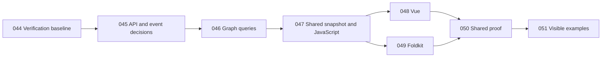

# Implementation plans

## Delivery loop and recovery, 2026-10-13

The maintainer adopted a lean loop. Each feature gets one numbered plan of a page or less. Implement it, run targeted tests plus `bun run verify` with the slice in `verification.config.json`, then do one review pass and commit. Do not add multi-judge reviews, hash ledgers, decision trails, or recovery packets. Run `bun run verify:full` at milestones.

Review, judgment, checkpoint, and execution notes from earlier work moved to [archive/](archive/). Links were rewritten, and the files are otherwise unchanged. Numbered plans, this index, integration records, and the JSON and script inputs read by checks stay here.

Main was red after Plan 099 because broad tests were deferred. One stale Foldkit delete-approval assertion still counted owner proposals as commands; Plan 099 had moved them to the batched publication lane. The shared connection-threshold harness also imported the Vanilla package `dist`, which the Vanilla app build had already emptied, and it now imports Vanilla source. The next slice ports Vanilla built-in UI to Vue and Foldkit; see [project progress](../research/PROGRESS.md).

The [2026-09-30 integration and cleanup record](integration-cleanup.md) records the approved commits, combined verification, measurement-race test repair, and recoverable archives. Plan completion statuses below retain their bounded acceptance requirements.

## Definitive project goal

As clarified by the maintainer on 2026-09-26, Flow aims to match React Flow's public interfaces as closely as each supported framework permits, and to make every example, UI component, and template in the React Flow catalogs achievable in every supported framework. Plain JavaScript, Vue, and Foldkit share this destination; future supported adapters inherit it.

The scope is defined by all entries in the [API reference sidebar](https://reactflow.dev/api-reference), [examples catalog](https://reactflow.dev/examples), and [UI sidebar](https://reactflow.dev/ui). These three catalogs are the definitive product target. Match public names, options, data shapes, events, and observable behavior wherever practical. Express hooks, providers, rendering, reactivity, and lifecycle through each framework's native conventions, with explicit mappings and reasons for differences.

Every catalog capability belongs on the roadmap, including advanced examples and templates. A capability may be delivered through shared core logic, an adapter, reusable UI, or an example integration. Capability gaps remain open until demonstrated in each supported framework. Existing bounded adapter milestones describe current progress; they do not limit the final goal. Parity claims still require reference evidence, and current architecture differences must be reviewed against the goal rather than assumed permanent.

[Plan 043](043-establish-definitive-react-flow-parity-goal.md) carried this decision into the project overview and authoritative progress checklist at `9a583d7`; catalog discovery followed at `1aa5915`. Plan 044 restored its verification baseline, and Plans 044-051 are complete. Plan 052 is complete at `f8b73f2`. Plans 053-062 below cover the next recommended chunks, beginning with measured geometry and rendering across all three hosts. Earlier deferrals of full adapter parity below are historical sequencing decisions. Their local completion boundaries remain valid.

## Authorized integration, 2026-10-11

The maintainer authorized commit, merge and cleanup of outstanding work. The integration combines the accepted Plan 082/085 recovery composition, Plan 087 factory, Plan 088 pure helpers and exact 96-cell accounting, Plan 089 core actor, Plan 090 standalone marker schemas, and nested resize containment/measurement fixes. The marker source is the approved JSON-boundary resumption, not the original stopped candidate.

All original checkouts are preserved as Git snapshots with refs under `codex/archive/flow-20261011/` inside the verified `outstanding-work.bundle`. Their ignored evidence and the checkout inventory are in `/Users/richardmcandrews/.codex/task-archives/flow-2026-10-11-integration`. Unaccepted native, connection-option, selector, appearance and provider-reference candidates remain recoverable there. Historical lease/dispatch entries below describe those archived attempts; they do not represent active verification ownership after cleanup.

The default verifier is restored to `full`. Current verification and integration results are recorded in [the integration record](integration-cleanup-2026-10-11.md). Broad parity and the remaining parent-plan contracts stay open.

## Feature-only parity continuation, 2026-10-11

The maintainer invoked p3-mode and suspended testing except for current feature implementation. [Plan 098](098-implement-connection-drag-threshold.md) resumes connection drag activation from integrated main. Its feature tests proceed with the implementation. Broad verifiers and calibration are deferred until final reconciliation. The current brief and decision trail are in `/Users/richardmcandrews/.codex/recovery/flow-parity-20261011/`.

## Planning history

### Temporary verification policy (2026-09-30)

The maintainer requested a lighter development gate while feature work continues. Run `bun run verify` with the baseline plus checks relevant to the active slice, selected in `verification.config.json` or through the CLI; see [tooling](../docs/tooling.md). Update the active scope when starting a new slice. This supersedes earlier plans' requirement to run every browser, consumer, research, and catalog gate on each iteration. Preserve explicit behavioral acceptance assertions and reference-proof requirements. Run `bun run verify:full` at integration and release milestones, and distinguish focused results from complete-suite acceptance in plan status updates. Changing the config default to `full` restores broad verification locally and in automatic CI.

Plan 001 was written against the original unborn `main` and is complete at `e393e3e`. Plans 002-010 were written with the improve skill on 2026-09-23 against that commit after a standard audit; the user selected all nine vetted findings. Read each plan fully, run its drift check and STOP conditions, and update its status row after the complete verification gate passes. Preserve unrelated work. Do not commit, push, or open a PR without operator instruction. Plan 011 was added on 2026-09-23 against `5274aef` and is complete. Plans 012-021 were written against `6e84008` as the next ten bounded scopes from `research/PROGRESS.md` and the Plan 011 baseline. The former handoff is a dated snapshot in `docs/archive/`; current status lives in `research/PROGRESS.md`. Later plans must re-read the contracts produced by earlier plans before executing; their drift checks and STOP conditions make that dependency explicit.

Plans 022-029 were written on 2026-09-24 against `5e5d496` using the open items in `research/PROGRESS.md`. They form one interaction and canvas UI chunk: reference boundaries, deterministic browser proof, multi-direction resize, gesture cancellation, custom drag handles, panel placement, and focused verification. They do not promise full xyflow or framework-adapter parity. Plan 029's keyboard proof exposed a native renderer-control activation defect; Plan 032 fixed native key ownership before Plan 029's proof resumed. The advisor checkout had uncommitted documentation changes when these plans were written; each executor must inspect live status and preserve them.

## Execution order and status

| Plan | Title | Priority | Effort | Depends on | Status |
| --- | --- | --- | --- | --- | --- |
| [001](001-stabilize-graph-and-rendering-contracts.md) | Stabilize the graph document and extensible rendering contracts | P1 | L | none | DONE — `bun run verify` passed in the isolated worktree |
| [002](002-reposition-descendants-on-update.md) | Reposition descendants after an authoritative parent update | P1 | S | 001 | DONE — `0f4fef2`, reviewed; verify passed |
| [003](003-render-graph-stacking-order.md) | Render nodes in the graph's stacking order | P1 | S | 002 | DONE — `090aeb1`, reviewed; verify passed |
| [004](004-cancel-invalid-group-drag.md) | Cancel a group drag when any participant becomes invalid | P1 | S | 002 | DONE — `7e31770`, reviewed; verify passed |
| [005](005-clean-up-failed-renderer-mount.md) | Clean up a host when its initial renderer mount fails | P1 | M | 001 | DONE — `ed89b4b`, reviewed; verify passed |
| [006](006-unify-saved-document-contract.md) | Derive the saved-document contract from the domain schema | P1 | M | 001 | DONE — `2bb0933`, reviewed; verify passed |
| [007](007-cancel-gestures-on-lifecycle-loss.md) | Cancel active gestures on Escape, blur, and pointer capture loss | P1 | M | 004, 005 | DONE — `a44a5df`, reviewed; verify passed |
| [008](008-refresh-project-status-docs.md) | Refresh the handoff, progress checklist, and dependency record | P2 | S | 001; schedule after 002-007 | DONE — `72db1db`, reviewed; verify passed |
| [009](009-index-visible-edge-endpoints.md) | Remove repeated edge scans from viewport culling | P2 | S | 003, 004 | DONE — `a58a3a5`, reviewed; verify passed |
| [010](010-update-only-affected-edges-during-drag.md) | Update only affected edges during a node drag | P2 | M | 002-005, 009 | DONE — `a1e1e3a`, reviewed; verify passed |
| [011](011-characterize-spatial-and-gesture-contracts.md) | Establish spatial and gesture baselines before changing core state | P1 | M | 001-010 | DONE — `b41072a`, reviewed; verify passed |
| [012](012-decide-spatial-state-from-core-prototype.md) | Decide spatial state from a core-only prototype | P1 | M | 011 | DONE — `94a5850` + `e709097`, reviewed; verify passed |
| [013](013-model-pointer-gesture-lifecycle.md) | Model pointer gesture states and finish cancellation boundaries | P1 | L | 011 | DONE — reviewed; `bun run verify` passed; native concurrent-pointer and pinch cases remain unverified |
| [014](014-add-first-node-resize-contract.md) | Add a first node resize contract through core and vanilla | P1 | L | 013 | DONE — reviewed; `bun run verify` passed; PROGRESS 116 remains open |
| [015](015-finish-node-movement-and-descriptions.md) | Finish node movement edges and custom descriptions | P1 | L | 013, 014 | DONE — reviewed; `bun run verify` passed; auto-pan, locking, and description scope proven |
| [016](016-establish-shared-adapter-proof.md) | Establish shared adapter proof on vanilla | P1 | L | 013-015 | DONE — reviewed; `bun run verify` passed; vanilla fixtures and 2 reference captures verified |
| [017](017-settle-javascript-api-and-package-consumer.md) | Settle JavaScript facade and prove packed consumer | P1 | L | 014-016 | DONE — reviewed; packed consumer typecheck and Chromium mount passed; verify passed |
| [018](018-build-reusable-canvas-ui.md) | Build the first reusable canvas UI layer | P2 | L | 015-017 | DONE — reviewed; verify passed; general overlay portals remain open |
| [019](019-build-foldkit-adapter-first-slice.md) | Build a Foldkit adapter against the shared contract | P2 | L | 016-018 | DONE — reviewed; Effect/platform aligned to rc.116; verify passed; shared and active-disposal tests passed |
| [020](020-build-vue-adapter-first-slice.md) | Build a Vue adapter against the shared contract | P2 | L | 016-018 | DONE — reviewed; Vue build and 3 browser tests passed; `bun run verify` passed (142 browser passed, 2 skipped) |
| [021](021-prepare-delivery-gates-and-release-decisions.md) | Establish delivery checks and a release dry run | P2 | L | 016-020 | DONE — architecture/docs/consumer gates and internal dry run pass; Flow license deferred; no publish or hosted CI claim |
| [022](022-map-interaction-parity-boundaries.md) | Map the next interaction parity boundaries | P1 | M | none | DONE — reviewed in isolated worktree; trace/fixture matrix gates passed |
| [023](023-isolate-browser-test-servers.md) | Isolate browser test servers from development servers | P1 | S | none | DONE — reviewed in isolated worktree; full verify and occupied-port proof passed |
| [024](024-define-multidirection-resize-geometry.md) | Define multi-direction node resize geometry in core | P1 | L | 022 | DONE — reviewed in isolated worktree; core contract and full verify passed with Plan 023's isolated browser ports |
| [025](025-wire-multidirection-resize-in-vanilla.md) | Wire multi-direction resize through vanilla | P1 | L | 023, 024 | DONE — reviewed isolated worktree; 8-direction, controlled-child, nested-bounds, culling/UI and removal cases; full verify passed (2 native skips) |
| [026](026-complete-gesture-cancellation-proof.md) | Complete deterministic gesture cancellation proof | P1 | L | 022, 023, 025 | DONE — reviewed isolated worktree; exact session and cancellation matrix; zero-frame, capture, fresh-gesture gates passed; native cases remain skipped |
| [027](027-support-custom-drag-handles.md) | Support custom drag handles in the vanilla renderer | P2 | M | 022, 025, 026 | DONE — reviewed; keyed markers, no-drag, focus/keyboard/group drag and normalized fixture comparison; full verify passed (2 native skips) |
| [028](028-add-canvas-overlay-placement.md) | Add placed panels and overlay portals to vanilla | P2 | L | 022, 023 | DONE — reviewed in isolated worktree; six placements, validation, focus/selection restoration, host-local portal, docs, and full verify passed |
| [029](029-prove-interaction-ui-boundaries.md) | Prove the new interaction and UI boundaries | P2 | L | 023, 025-028 | DONE — reviewed; focused screenshots, keyboard/accessibility, capability matrix, parity trace and full verification passed |
| [030](030-render-canvas-panel-placements.md) | Complete canvas panel placement wiring | P1 | M | 028 | DONE — reviewed; typed host API, six visible placements, teardown restoration and full verify passed |
| [031](031-enable-keyboard-node-resizing.md) | Enable keyboard resizing for directional controls | P1 | M | 024-026, 030 | DONE — reviewed; arrow mapping, atomic controlled/uncontrolled resize, focus/cancellation and ancestor-hidden lifecycle pass full verify |
| [032](032-preserve-native-keyboard-activation-in-custom-nodes.md) | Preserve native keyboard activation in custom nodes | P1 | S | 027, 031 | DONE — reviewed; native keyboard ownership, focus, editing, no-drag, controlled state, node movement, and resize regressions pass full verify |
| [033](033-align-adapter-nested-graph-semantics.md) | Align framework adapters with core nested-graph semantics | P1 | M | none | DONE — `7bb52bb`; full verify passed |
| [034](034-fix-vue-drag-coordinate-and-cancellation.md) | Fix Vue child dragging and preview cleanup | P1 | M | 033 | DONE — `8549283`; cumulative full verify passed |
| [035](035-cover-all-core-source-in-architecture-check.md) | Enforce the package-to-app boundary across core source | P1 | S | none | DONE — `92eb859`; architecture and full verify passed |
| [036](036-clear-and-gate-code-quality-baseline.md) | Clear the quality baseline and add it to verification | P1 | L | 033-035 | STALE — source lint now passes at `1aa5915`; remaining formatting and verify integration are superseded by 044; retain the original execution record |
| [037](037-prove-native-multi-pointer-lifecycle.md) | Prove native multi-pointer cancellation | P1 | L | none | BLOCKED — current macOS/Playwright 1.62.1 setup has no native-capable device harness; keep both native cases skipped |
| [038](038-capture-reference-resize-outputs.md) | Capture comparable reference resize output | P2 | M | none | DONE — `12be1b5`; repeated reference capture and full verify passed |
| [039](039-add-graph-property-and-lifecycle-cases.md) | Add property and lifecycle proof for graph contracts | P2 | M | none | DONE — `f457b8d`, `032db7d`; full verify passed |
| [040](040-establish-browser-performance-budgets.md) | Measure browser hot paths and set performance budgets | P2 | M | none | DONE — `e2ac3cd`, `15e467a`; full verify passed; no stable latency budget justified |
| [041](041-audit-visual-and-accessibility-output.md) | Broaden visual and accessibility evidence | P2 | L | 033, 034 | DONE — `045e158`, `e99f624`; full verify passed; manual and screen-reader cells remain unverified |
| [042](042-expose-completed-interactions-in-playground.md) | Expose completed vanilla interactions in the playground | P2 | M | none | DONE — `c1ff849`; full verify passed |
| [043](043-establish-definitive-react-flow-parity-goal.md) | Establish the definitive React Flow parity goal across frameworks | P1 | S | none | DONE — goal documentation landed; Plan 044 full local verification passed; catalog parity work remains tracked in 045-051 |
| [044](044-restore-verification-baseline.md) | Restore the verification baseline | P1 | M | none | DONE — reviewed in an isolated worktree; full `bun run verify` passed with two existing native multi-pointer skips; consolidated with Plans 045-051 |
| [045](045-map-public-api-and-state-contracts.md) | Map public interfaces and decide state and event contracts | P1 | L | 044 for final verification | DONE — reviewed in the isolated worktree; full local verify passed; mapping and state-contract gaps remain explicit |
| [046](046-align-public-graph-queries.md) | Add reference-shaped graph query helpers | P1 | M | 044, 045 | DONE — reviewed in the isolated worktree; full verify passed; reference runtime parity remains unverified |
| [047](047-expose-javascript-state-reads.md) | Expose authoritative state through the JavaScript controller | P1 | L | 044, 045, 046 | DONE — reviewed; snapshot/state reads, accepted notifications, consumer and browser coverage passed full verify; native pointer skips remain |
| [048](048-add-vue-state-composables.md) | Add Vue-native state reads and composables | P2 | M | 045, 047 | DONE — reviewed schema-based deduplication and lifecycle coverage; full verify passed with two existing native-pointer skips |
| [049](049-add-foldkit-state-queries.md) | Add Foldkit model queries and typed state observation | P2 | M | 045, 047 | DONE — reviewed Runtime ports and controlled-state coverage; full verify passed with two existing native-pointer skips |
| [050](050-prove-shared-read-contract.md) | Prove shared state and query behavior across all hosts | P2 | M | 046, 047, 048, 049 | DONE — reviewed four shared fixtures through all production hosts; full verify passed with two existing native-pointer skips |
| [051](051-demonstrate-state-api-in-playgrounds.md) | Demonstrate node updates and save/restore across frameworks | P2 | L | 046, 047, 048, 049, 050 | DONE — reviewed three public-API demos, browser coverage, and bounded layouts; full verify passed with two native-pointer skips |
| [052](052-complete-public-graph-editing.md) | Complete public graph editing across JavaScript, Vue, and Foldkit | P1 | L | 044-051 | DONE — all eight work packages and listed acceptance criteria verified; full-entry React Flow parity remains explicitly open |
| [053](053-unify-measured-geometry.md) | Unify measured geometry and readiness across hosts | P1 | L | 052 | DONE — shared three-host production fixture, Foldkit observer teardown, pinned-upstream comparison, and independent full `bun run verify` pass |
| [054](054-complete-renderer-contracts.md) | Complete node, edge, and handle renderer contracts | P1 | L | 053 | DONE — approved renderer contracts across three hosts; independent full `bun run verify` passed |
| [055](055-complete-viewport-api.md) | Complete viewport operations and coordinate contracts | P1 | L | 053; 054 for rendered examples | DONE — public viewport operations and coordinate contracts verified across hosts; extent and CSS-transform limits are explicit |
| [056](056-complete-interaction-lifecycles.md) | Complete shared gestures, connections, and lifecycle events | P1 | L | 053-055 | DONE — bounded production lifecycle/gesture evidence passes across hosts; host-specific unsupported cells and trusted native capture for 060 remain explicit |
| [057](057-finish-public-api-correspondence.md) | Complete remaining public contracts and member-level correspondence | P1 | L | 053-056 | IN PROGRESS — 066 ownership phase approved; 063/064/068 remain blocked; 065 geometry integrated at77a725e and189 original cells accepted in isolated composition; 075 legacy guard/client approved;067/070 source prerequisites accepted;069 architecture approved with product/member work pending |
| [058](058-deliver-reusable-canvas-and-ui.md) | Deliver reusable canvas UI and catalog components | P2 | L | 053-057 | IN PROGRESS. Nine recipes have partial three-host evidence; final verify session 68756 passed Vanilla 299 / 2 existing skips, Vue 112, and Foldkit 117. Eight recipes, both templates, built-in option gaps, rejection/lifecycle/accessibility proof, and upstream comparison remain open |
| [059](059-complete-example-catalog.md) | Complete catalog examples through supported APIs | P2 | L | 053-058; 060A for stress budget | IN PROGRESS — WP1 acceptance registry verified for all 67 dated examples; four recipes are partial, 63 are none, and no gallery renders examples; recipe families remain open |
| [060](060-establish-catalog-wide-proof.md) | Establish catalog-wide proof | P2 | L | A: 053-056; B: 057-059 | IN PROGRESS. Final full verify session 68756 passed; 122 calibration records retain empty/pending timing budgets. Current-site metadata check passed 208/200. Local Vanilla collector delivery is verified; native device, broader accessibility, all-host/hosted/long-term collector evidence, and Phase B remain open |
| [061](061-package-all-supported-adapters.md) | Package Foldkit and verify every adapter from tarballs | P2 | L | 053-058 | DONE. Four private 0.0.0 archives and all three native UI consumers passed fresh release dry-run and final full verify session 68756; separate HMR proof passed independent review. Current public exports are packaged; complete recipe matrices, upstream runtime parity, licensing, and publication remain later work |
| [062](062-prepare-versioned-delivery.md) | Prepare versioned delivery and the first reviewed release | P2 | L | 060B, 061; actual catalog coverage | TODO |
| [063](063-finish-provider-server-initialization.md) | Finish provider initialization, server geometry, and defaults | P1 | L | 053/055; accepted 057 slices | BLOCKED — initial reference subset approved; extended capture exhausted two focused revision rounds without fixture promotion |
| [064](064-complete-selector-owner-lifecycles.md) | Complete native selector and owner lifecycle contracts | P1 | L | 056; accepted 057 slices | BLOCKED — final revision exhausted; browser assertion preflight fails quality; production/reference/packed/full acceptance incomplete |
| [065](065-complete-measured-handle-refresh.md) | Refresh measured handle centers and dynamic edge endpoints | P1 | L | 053/054; accepted 057 refresh | DONE in isolated acceptance candidate — execute revalidation passed focused verify in52.599s:414 units/62 browsers/three packed consumers;63 original members/189 cells retained with0ownedunresolved;18implemented and171reviewed differences; bounded acceptance patch integrated on 2026-10-11 |
| [066](066-close-public-member-acceptance.md) | Decompose and close every remaining public member acceptance cell | P1 | L | 057 WP1; closure 063–065,067–074 and discovered children | IN PROGRESS — structural phase and original063 reference subset independently pass fullverify in accepted-public-prerequisites; all8076 semantic cells remain open |
| [067](067-complete-origin-connection-contracts.md) | Complete node origin and connection rendering public contracts | P1 | L | 065,054,056; 066 decomposition; reviewed 070 design | IN PROGRESS — 080 origin/native and078/082 directed integrity source accepted; complete070 source stage approved;081/083 host activation BLOCKED;084 core repair accepted through085; original generic/native/full acceptance remains open |
| [068](068-complete-appearance-accessibility-config.md) | Complete appearance, accessibility, and native configuration members | P1 | L | 054/056; 066 decomposition | BLOCKED — final source revision exhausted; Vanilla appearance suite fails edge-description locator on second run; full acceptance incomplete |
| [069](069-support-schema-backed-data-extensions.md) | Support schema-backed typed node and edge data extensions | P1 | L | 057 schemas; 066 decomposition | IN PROGRESS — separate Effectful API/isolation/Foldkit projection architecture independently approved with compiler and mounted probes; product implementation and member acceptance remain pending |
| [070](070-migrate-origin-aware-persistence.md) | Migrate origin-aware persistence while preserving legacy v1 contracts | P1 | M | 066 decomposition; reviewed 067 origin schema/geometry snapshot | IN PROGRESS — complete source/method/client stage APPROVED through082; primary reproduced708 units/234 browsers/three packed consumers;081 rendered restoration/full/release pending |
| [071](071-complete-interaction-callback-members.md) | Complete public interaction options and native callback variants | P1 | L | 066 decomposition,064; 069 before final acceptance | TODO — ownership decomposition approved; field/default/lifecycle design review required before source |
| [072](072-close-instance-utility-contracts.md) | Close public instance methods, change arrays and utility option contracts | P1 | L | 066 decomposition,064,067; 069/070 before final acceptance | TODO — ownership decomposition approved; field/default/lifecycle design review required before source |
| [073](073-complete-marker-minimap-type-contracts.md) | Complete marker, edge renderer and minimap type contracts | P1 | L | 066 decomposition; accepted rendering/UI slices; 069 before final acceptance | TODO — complete101-member design prerequisite independently APPROVED; source blocked on checked075, endpoint/color codec and native registry review |
| [074](074-complete-native-node-edge-fields.md) | Complete native Node and Edge field and renderer-prop contracts | P1 | L | 066 decomposition,063,065,067,068; 069 before final acceptance | TODO — ownership decomposition approved; field/default/lifecycle design review required before source |
| [075](075-review-native-field-persistence.md) | Review native node-option persistence before extending live schemas | P1 | M | 066 ownership;068 matrix;070 design | IN PROGRESS — bounded frozen legacy guard/client independently APPROVED with fullverify; final native/origin/v2 acceptance waits on068/069 and outstanding native/origin work;065 geometry prerequisite satisfied |
| [076](076-resume-snapshot-and-handle-refresh.md) | Resume Foldkit snapshot callers and measured-handle refresh | P1 | L | accepted 075 guard/client; 065 architecture and 066 decomposition | DONE — bounded implementation independently APPROVED; focused verify passed 409 units,43 selected browsers,three packed consumers; integrated on main at77a725e |
| [077](077-retain-versioned-native-schema-fields.md) | Retain approved live native metadata | P1 | M | 075; before070 | STOPPED — frozen candidate passes actual Runtime proof; mandatory verifier fails obsolete live empty-label rejection;080 owns integration dependency |
| [078](078-complete-directed-handle-integrity.md) | Preserve directed named-handle identity and frozen readers | P1 | M/L | 067/075; before070 activation | BOUNDED CORE APPROVED —core integrated through accepted082 ordering repair and complete070 v2/public proof;081 full host activation pending |
| [079](079-migrate-origin-guard-fixtures.md) | Assemble origin core with Schema-derived guard fixtures | P1 | S | frozen067 core | STOPPED —419 units/three consumers/57 Vanilla browsers pass; reconnection measurement discrepancy under independent investigation |
| [080](080-integrate-origin-native-test-contracts.md) | Integrate reviewed origin/native test dependencies | P1 | S/M | accepted079; frozen077 | BOUNDED SOURCE APPROVED — primary reproduced506 units,170 browser tests and three packed consumers; complete070/host integration pending |
| [081](081-wire-origin-and-connection-hosts.md) | Activate origins and connection contracts in all native hosts | P1 | L | accepted080/078;070 source/client migration; approved reference capture | BLOCKED — candidate frozen after final permitted required-quality repair failed; six formatting failures, native generation registration and remaining acceptance obligations unresolved; no source approval |
| [082](082-integrate-ordered-legacy-and-current-gestures.md) | Integrate exact frozen reader ordering and current gesture expectations | P1 | M | frozen complete070; accepted078/core and reference design | DONE bounded source stage — primary and independent source approval;708 units/234 browsers/three packed consumers reproduced;117-file frozen composition feeds081 |
| [083](083-resolve-native-host-blockers.md) | Resolve native measurement lifecycle, raw creation validation and final integration blockers | P1 | L | accepted082; exact stopped081 repair input; frozen capture helper | BLOCKED — quality repair2 still fails three readable-spacing assertions; frozen source unaccepted; unchanged capture19/19 and focused units31/31 pass; core origin loss, issued-lease fault cleanup, genuine HMR and retained matrix/full gates remain open |
| [084](084-preserve-origin-through-edits.md) | Preserve document origin through core edits and Schema result transport | P1 | S | accepted082 only | DONE via085 — original084 frozen failure retained; new resumption source APPROVED after independent focused verification; native integration remains separate |
| [085](085-accept-origin-edit-resumption.md) | Complete origin-edit acceptance after explicit continuation | P1 | S | accepted082; frozen084 repair input | DONE — primary/cold source APPROVE frozen7b3b1186; same-byte focused verification754units/54browsers/3consumers passed; old083/084 snapshots preserved |

| [086](086-complete-native-parity-acceptance.md) | Complete native lifecycle and restoration acceptance | P1 | L | accepted085; frozen083 repair input | IN PROGRESS — sole shared lease; render9/9, admission/resize24/24, auto-pan7/7, retained268/268 and three real archives/same-build HMR pass; genuine older-build fourth CLI passes settled+active2/2 with official nonzero active flush; primary receipt/protected audit0; complete pre093 source/evidence freeze bbcada93 retained;093 genuine two pinned captures precede production; final combined focused/full/release/SOURCE pending |

| [087](087-create-typed-data-contract-factory.md) | Create typed-data contract factory and shared integrity foundation | P1 | M/L | accepted085; approved069 architecture | DONE — exact factory freeze2dee299d independently approved; primary focused0/765units/3real archive probes/3persistence regressions; actor/native/all300generic cells remain open |

| [088](088-complete-path-helper-parity.md) | Prove pure path helpers and repair the captured same-side predicate | P1 | M | accepted085; bounded072 child/metadata review | DONE bounded — final frozen source/cold review accepted; primary focused0/1554units and3actual archives each504tuples; exact32members/96cells closed,7791open; whole072/native/full integration remain open |

| [089](089-create-isolated-typed-flow-actor.md) | Create scoped typed graph actor with isolated deliveries and checkpoint staging | P1 | L | accepted087; approved069 codec architecture | DONE — exact SOURCE revision1 b86b0812 accepted by primary+cold; root focused0/871units/3real archives/3selected persistence cases; diagnostics retain original whole Causes and logger-defect cleanup; integrated bounded core foundation; all300generic cells OPEN |

Status values: TODO, IN PROGRESS, DONE, BLOCKED with a reason, STALE with its replacement, or REJECTED with a reason.

Plans 002-010 were executed and reviewed in the isolated worktree `/Users/richardmcandrews/.codex/worktrees/flow-plans-002-010/flow`, based on `e393e3e`. Their nine commits are now on `main` through fast-forward `a1e1e3a`.

| [090](090-create-marker-configuration-foundation.md) | Add marker configuration/value Schema foundation | P1 | M | accepted087; approved073 nested design | DONE bounded — freeze65baa020; primary and cold SOURCE approve, root focused0/1197units51files and3realarchives reproduced; original STOP retained; graph/native integration and303cells open |

## Dependency notes

- Land 002 before 003 and 004: all three touch node reconciliation, and 002 establishes the absolute-position update behavior they must preserve.
- Land 004 and 005 before 007: general gesture cancellation should build on correct group cancellation and guaranteed mount cleanup.
- Run 008 after the P1 implementation plans if its handoff should describe their results; it can be moved earlier for a documentation-only handoff.
- Land 003 and 004 before 009, then 009 before 010, to keep the culling and drag-edge performance work grounded in a stable browser reconciliation path.
- 006 is independent of the browser plans and should land before freezing or distributing the public persistence contract.
- Foldkit and Vue adapter work should wait for the graph/browser contract fixes and shared conformance design. The separate direction suggestions from the audit were not part of the nine selected defect/maintenance findings.
- 011 characterized spatial and gesture paths. Its 4,000-node local timings did not justify an index, so 012 compares a core-only candidate with the current scan before any production index integration.
- 013 stabilizes gesture state before 014 adds resize and 015 adds node auto-pan. 016 then captures the shared behavioral contract. 017 settles package and JavaScript consumption before 018's optional UI layer.
- 019 and 020 run the same suite on Foldkit and Vue. 021 adds delivery checks after package and adapter contracts exist. The plans are numbered in recommended order; 012 can run independently of 013-015 in separate isolated checkouts, but their implementation changes must be reconciled before landing.
- 022 defines observable boundaries before the resize, gesture, drag-handle, and overlay slices. 023 fixes a reproduced stale-Vite test-server problem; it can run alongside 022 but must land before browser-heavy 025-029.
- 024 keeps signed resize and extent math in core. 025 wires one atomic position/size result through vanilla; 026 then tests cancellation against the final resize gesture. 027 builds on those node interaction rules.
- 028 is independent of resize after 022-023 and can execute in a separate worktree. 029 follows the feature slices and records what the three adapters and pinned reference actually prove.
- Plan 029's renderer-button test found that the canvas node key handler prevented native Enter activation. Plan 032 fixed native key ownership; Plan 029 then completed its keyboard and capability evidence.

## Coverage recorded for Plans 012-021

`research/PROGRESS.md` is authoritative. This table records the scope and limits of the earlier 012-021 rollout; a checklist box closes only when its whole contract and test boundary pass.

| Open checklist area | Planned scope | Completion limit |
| --- | --- | --- |
| Spatial and gesture research/state (46 is done; 48, 52-53, 71-72 open) | 012, 013, 016 | 012 is a prototype decision; a winning index needs a separate integration plan. Full input mapping and stable performance budgets may need follow-up. |
| Canvas and node interactions (82, 88, 105, 110, 116, 119, 133) | 013-015, 018 | 014 is a first lower-right resize contract; broader resize parity remains separate. |
| Built-in canvas UI (155-160) | 018 | Check individual UI items only after browser proof and license decision. |
| Effect/public API and vanilla consumer (167, 169, 175, 177, 188) | 013, 015, 017 | Collector processing/storage/query at 167 is separate from browser OTLP transport. |
| Foldkit and Vue (192-208) | 019, 020 | Both must run Plan 016's shared fixtures; scaffolds alone do not close adapter conformance. |
| Shared proof (216-225) | 012, 016-020 | 216 and the suite start in 016; visual, touch, accessibility, property, lifecycle, and large-graph budgets remain open until their full matrices pass. Packed consumer proof is 017. |
| Delivery (22-25, 232-237) | 021 | Ultracite cleanup at 22 and actual publication at 237 require later scoped work; 021 configures checks, docs, and a dry run without claiming hosted CI or a release. |

## Coverage of the next interaction and UI chunk

| Open checklist area | Planned scope | Completion limit |
| --- | --- | --- |
| Input/UI reference traces and test mapping (47-48, 52) | 022 | Classify every selected cell; leave whole-checklist items open until their full coverage is demonstrated. |
| Resize nodes (116) | 024-025 | Eight directions, local position, extents, controlled ownership, browser geometry, and cancellation; record any remaining hierarchy semantics before checking 116. |
| Gesture cancellation and input tests (133, 219, 223) | 026 | Native concurrent pointer and two-contact capture remain unverified until exercised in a suitable device/browser harness. |
| Panels and overlay portals (158) | 028 | Close only after placement, caller ownership, pointer exclusion, and destroy restoration are browser-tested. |
| Visual and accessibility checks (218, 221) | 029 | Focused checks for this chunk are not whole-project visual coverage or a complete accessibility audit. |
| Reference drag-handle deviation | 027 | This is a feature parity gap from the two pinned captures, not a currently unchecked PROGRESS row. |
| Browser proof isolation | 023 | Fixes a reproduced local test-server contamination path; it does not imply hosted CI is green. |

## Findings considered and rejected

- Split the 3,556-line vanilla host immediately: structural cost is real, but a broad extraction before these contract fixes would add high regression risk. Reconsider after interaction characterization and a shared suite.
- Broad full-adapter feature parity in this chunk: Foldkit and Vue still have bounded surfaces, and adding vanilla gestures to them before the contracts settle would duplicate unstable behavior. Plan 029 records capability gaps for a later adapter chunk.
- No security issue met the evidence threshold in the audited host and core paths. Imported upstream artifacts and dependency advisories were not audited.

## September 25 advisory: next ten scopes

Plans 033-042 were written against `f9b2b13` using `research/PROGRESS.md`, the completed interaction plans, current adapter source, and the browser evidence matrix. This is a reliability and proof chunk before broad framework-feature parity or public release. The P1 sequence is 033 then 034, with 035 independent; run 036 after those source edits to avoid a wide formatter/lint conflict. Plan 037 can proceed separately if a native-capable device is available. Plans 038-042 are independent except for 041's adapter prerequisite and may use separate worktrees; their browser gates should run serially on strict test ports.

| Plan | Checklist or contract addressed | Completion boundary |
| --- | --- | --- |
| 033-034 | Shared adapter graph and Vue gesture correctness; 217, 223 | Three-level/hidden shared output and actual Vue preview/semantic state, without claiming vanilla feature parity |
| 035-036 | Architecture and quality gates; 22-23 | Non-domain core imports rejected; `bun run check` clean and included in `verify` |
| 037 | Gesture cancellation and input; 133, 219, 223 | Real native pointer capture; synthetic CDP events do not close these cells |
| 038 | Resize/reference research; 48, 52, 116 | One equivalent observed reference/Flow output comparison, not blanket parity |
| 039 | Graph property and lifecycle proof; 222-223 | Deterministic generated invariants and rendered cleanup assertions |
| 040 | Performance research and budgets; 53, 224 | Browser reconcile and gesture measurements plus a stable gate budget |
| 041 | Visual, input, and accessibility; 218-221 | Matrix names browser/device/screen-reader evidence; unavailable cells stay open |
| 042 | Inspectable vanilla demonstration | Completed host capabilities shown in the main playground without new core contracts |

### Vetted findings behind the selection

| Finding | Category | Impact | Effort | Fix risk | Confidence | Evidence |
| --- | --- | --- | --- | --- | --- | --- |
| Vue child drag emits absolute coordinates as local | correctness | Child jumps after drag | S | LOW | HIGH | `apps/vue/src/FlowCanvas.ts:135-168`; `packages/core/src/domain/flow-graph.ts:52-65` |
| Vue cancellation leaves a DOM transform; selector lookup trusts an arbitrary ID | correctness | Stale visual position or failed drag | M | MED | HIGH | `apps/vue/src/FlowCanvas.ts:164,184,225-234`; `packages/core/src/domain/flow-values.ts:3` |
| Vue/Foldkit duplicate one-level graph resolution | architecture | Grandchildren/culling and hidden descendants diverge from core | M | MED | HIGH | `apps/vue/src/FlowCanvas.ts:135-145,186-187`; `apps/foldkit/src/graph.ts:72-75,159-165`; `packages/core/src/domain/flow-graph.ts:46-68` |
| Core-to-app rule covers only the domain subdirectory | architecture | A future dependency inversion can pass verification | S | LOW | HIGH | `scripts/architecture-rules.ts:117-129`; `scripts/check-architecture.ts:65-80` |
| Configured Ultracite check is absent from verify | DX | CI can pass while lint/format fails | L | MED | HIGH | `scripts/verify.ts:5-20`; `docs/tooling.md:37-41`; `research/PROGRESS.md:22` |
| Native multi-pointer cases remain skipped | tests | Capture/cancellation paths unverified | L | MED | HIGH | `apps/vanilla/e2e/advanced-gestures.e2e.ts:356-359`; `docs/browser-and-accessibility.md:5` |
| Browser reconcile and minimap hot paths lack budgets | performance | Scaling risk is unmeasured | M | LOW for measurement | HIGH for code pattern, MED for user impact | `apps/vanilla/src/edge-renderer.ts:185-196`; `apps/vanilla/src/canvas-ui.ts:171-188`; `scripts/bench-flow-geometry.ts:61-66` |

Direction choices are separate from defects: Plan 038 narrows a reference comparison; Plan 042 makes completed vanilla interactions inspectable. Broad Vue/Foldkit feature parity and package release remain later decisions. The first-slice adapters have only six shared scenarios (`research/fixtures/README.md:18-45`), and packages remain private at `0.0.0` with licensing deferred (`docs/release-process.md:1-11`).

### Considered and deferred in this audit

- An immediate split of the roughly 4,200-line `apps/vanilla/src/mount-flow.ts` would touch tightly coupled gesture and cleanup state. Revisit after Plans 037, 039, and 040 characterize the relevant behavior; a broad extraction now has higher regression risk than the selected correctness work.
- A spatial index is not justified by the earlier 4,000-node core prototype. Plan 040 measures browser hot paths before selecting an optimization.
- Full framework-feature parity and public package release are not included in these ten scopes. The shared contract and delivery decisions need the selected correctness/proof results first.

## September 26 selected recommendations: public reads and graph queries

Plans 044-051 were written against `1aa5915` after the maintainer selected the recommendations. This is a scoped planning pass, not a fresh security, performance, or whole-catalog audit. Only `plans/` was changed by the advisor. Current source, the authoritative checklist, and the 208-entry catalog snapshot informed the plans. The snapshot contains 200 capabilities plus eight navigation entries; those counts are not parity percentages.

Start with 044, then 045. Baseline repair is necessary because read-only checks found stale generated API docs, catalog Markdown formatting, and TypeScript diagnostics. `bun run lint` separately passes. Standalone `tsc --noEmit` also reports a missing built package, so 044 must reproduce using the configured build-aware typecheck. No fresh full verification pass is claimed by this planning work.

### Execution dependencies

Plan 045 can gather read-only evidence during 044 but cannot finish acceptance before the gate is green. Plans 048 and 049 may execute independently after 047 in isolated worktrees. Shared docs and index updates need reconciliation by one owner; full browser gates run serially. Plan 045 must settle notification ordering, accepted versus proposed state, mutation safety, reentrancy, and disposal, then refresh the downstream plans before dispatch. They are dependency-blocked implementation plans until that decision exists.

### Checklist mapping and limits

| Checklist area | Plans | Completion boundary |
| --- | --- | --- |
| Quality checks and local delivery gate | 044 | Current full local verify plus lint/format integration; no hosted CI claim |
| API correspondence | 045 | Canvas, Node, Edge, instance, selected hooks and event families mapped; complete API inventory remains open |
| Graph queries | 046 | Three public utilities; existing edge-query semantics retained; bounds/path helpers deferred |
| JavaScript API and framework coverage | 047-049 | Accepted-state reads and native observation; Foldkit remains an app prototype |
| Shared evidence | 050 | Identical Flow fixtures through real hosts; upstream comparison remains separately classified |
| Catalog examples | 051 | Updating Nodes subset, save/restore, and query inspector in all hosts; broader example/UI checklists remain open |

Broad pointer lifecycle callback implementation, the remaining hooks, measurement/internal-node APIs, Foldkit package promotion, UI component/template delivery, and catalog-wide proof remain subsequent chunks. Plan 045 records their relationships and reasons for deferral. Native multi-pointer Plan 037 remains blocked by the device-proof requirement; these plans do not supersede it.

### Alternatives considered for this chunk

- Start reusable UI components immediately: gives earlier component output, but inspector/search/data-driven components need stable reads. Plan 051 provides visible output while the shared API is established.
- Implement every API member together: would expand the design and three adapters too far before shared proof. Plan 045 maps gaps first, then this chunk implements a bounded subset.
- Replace the old edge-returning helpers in place: risks silently changing consumers. Plan 046 adds the reference-shaped public helpers and documents the existing semantics.

## Next milestone: public graph editing

[Plan 052](052-complete-public-graph-editing.md) was written against `e653e0a` on 2026-09-26. Plans 044-051 have delivered bounded state reads and shared fixtures. The next related chunk is the write side: collection additions/replacements, node and edge updates, JSON data, atomic deletion, and equivalent production APIs in each host.

The recommendation is to finish these shared operations before expanding reusable UI. Measurement and viewport parity are the strongest alternative, and follow this milestone; a full lifecycle callback pass and Foldkit package extraction remain separately bounded work. Plan 052 is one milestone with eight verifiable work packages, rather than a claim that one unreviewed implementation should change every host at once.

1. Decide write ownership and capture pinned reference behavior.
2. Add edge data and node deletion policy to shared schemas/persistence.
3. Implement atomic edit preparation, validation, and typed failures.
4. Deliver JavaScript methods and the first visible editing controls.
5. Deliver Vue methods and prove document/split-model bindings.
6. Deliver Foldkit typed requests/results and lifecycle cleanup.
7. Prove shared edits and demonstrate Updating Nodes and Delete Middle Node subsets in all hosts.
8. Complete reference comparison, packed-consumer proof, and checklist/catalog updates.

Order is 1 → 2 → 3 → 4 → {5, 6} → 7 → 8. Vue and Foldkit may proceed independently after the shared/JavaScript contract is verified, if parallel execution is authorized. Full browser gates remain serial. New operation types must migrate every exhaustive consumer in the same integration wave.

### Checklist mapping

- Graph schemas and persistence: edge data and explicit node deletion protection, with backward-readable version-1 documents.
- Public API correspondence: named write methods and typed failures, while all other instance members remain tracked gaps.
- Framework coverage: the same accepted/proposed graph edit semantics through real JavaScript, Vue, and Foldkit entry points.
- Example coverage: visible graph editing and neighbor reconnection with tests; broader styling, custom renderers, and Computing Flows remain open.
- Parity evidence: reproducible pinned cases plus explicit intentional differences. Passing shared Flow fixtures alone does not close reference parity.
- Testing/delivery: atomic rollback, invalid graphs, active-gesture removal, disposal, package-consumer checks, and complete local verification.

Planning-time read-only quality/docs/catalog checks passed. The preceding implementation turn's full gate passed on the Foldkit fix now committed at this base; it was not rerun as part of this planning pass. Existing native-input skips remain open. The advisor changed planning files only; source/status documentation updates are assigned to the executor within Plan 052.

## September 27 selected roadmap: all next recommended chunks

The maintainer selected all recommended follow-on chunks after Plan 052. These ten plans were written against clean `main` at `f8b73f2`. The advisor changed only `plans/`; no implementation or full verification run occurred during planning. This is targeted roadmap specification, not a new nine-category audit. Source entry points, standards, current checklist, completed plan boundaries, the dated catalog, and official API/example/UI landing pages were inspected. Private Pro source, all upstream page members, dependency advisories, hardware benchmarks, manual accessibility, and collector delivery were not audited in this pass.

### Recommended sequence

1. **053 then 054:** common measured geometry and native renderer contracts, including real Foldkit edge paths.
2. **055 then 056:** viewport operations followed by gestures, connection behavior, and lifecycle events.
3. **057 then 058:** finish member-level public contracts and reusable canvas/UI components.
4. **059:** deliver example families through those public contracts. Advanced integration choices receive bounded child designs before implementation; the parent stays open until its required families land.
5. **060A starts after 053-056:** establish proof registry, device strategy, and benchmark environments/budgets while API/UI/example work proceeds. **060B closes after 057-059:** run the completed capability matrix. This two-stage boundary avoids a dependency cycle with the stress example in 059.
6. **061 after 053-058:** package Foldkit and test every adapter from tarballs. This can proceed alongside 059/060; final archives must be retested after later exports land.
7. **062:** prepare a concrete release candidate with actual coverage and support claims. Publication requires explicit approval after license, version, artifacts, and evidence are reviewable.

Plan numbers identify work ownership, not permission to run all source changes concurrently. Most plans touch shared host contracts, catalogs, and conformance drivers. Reconcile each prerequisite before its dependent implementation, use isolated worktrees for dispatched execution, and run browser gates serially. Each plan contains its own commands, current-state excerpts, test cases, ownership rules, completion limits, and STOP conditions. Later plans must refresh against landed contracts; a stale snippet cannot justify reverting prerequisite work.

### Checklist coverage

| Open checklist area | Owning plans | Completion boundary |
| --- | --- | --- |
| Measured geometry, readiness, and internal-node contracts | 053 | Real host-fed geometry and lifecycle proof; no automatic spatial-index decision |
| Custom rendering and handle/edge parity | 054 | Native registries, measured paths, labels/markers, lifecycle, bounded reference output |
| Full viewport instance and coordinate APIs | 055 | Public operation/result/event contracts, fit/readiness and container-offset proof |
| Pointer/keyboard state, resizing, cancellation, connections, lifecycle diagnostics | 056 | Shared production-host fixtures; native device proof closes separately in 060 |
| Complete public API correspondence, state/change utilities, async deletion, persistence | 057 | All API members inventoried, implemented batches and owned residual child plans; no mutable-store shortcut |
| Built-in canvas UI, all catalog UI components/templates | 058 | Native exports/recipes and actual per-host user outcomes; original implementation and license boundaries |
| Every catalog example including advanced optional integrations | 059 | All dated example journeys work in all hosts; Pro reference limitations stay visible |
| Research-test mapping, visual/input/a11y/property/lifecycle proof, performance budgets, collector delivery | 060 | Environment-specific evidence and validated claims; unsupported environments remain open |
| Reusable adapters and installation from packed packages | 061 | Native Vue/Foldkit/core/vanilla tarball consumers, styles/types/peers/lifecycle, separate HMR proof |
| Release/changelog automation, docs/tutorials, licensing, versioning, publication | 062 | Reviewed candidate first; actual publication and registry consumer proof only after approval |
| Upstream review and future catalog additions | 057-060, 062 | Member and sidebar drift reviewed at milestones without deleting dated evidence or open gaps |

### Exhaustive dated catalog allocation

[The allocation manifest](next-chunks-coverage.json) assigns all 200 capability entries and retains all eight navigation entries from the September 26 baseline. Each capability has one primary owner, related plans, all three required hosts, and proof/package/release gates. API page ownership does not replace member-level acceptance in 057. Existing completed subcases remain useful evidence; their catalog entries remain owned until their full target is demonstrated.

Run `bun run plans/check-next-chunks.mjs` to verify exact URL/title/Pro-flag coverage, owner files, required hosts, and the ten plan records. It is read-only and does not change the authoritative research checklist. Planning coverage is not a parity percentage.

### Decisions and alternatives

- **Primary recommendation:** geometry and rendering first, then viewport/interactions/API/UI, with visible examples and proof in every slice. This addresses the documented host differences before layering more recipes on them.
- **Packaging earlier:** 061 can run once contracts through 058 settle; doing it before 053-056 would move unstable app boundaries and create unnecessary migration churn.
- **More demos first:** useful for a prototype, but would force private adapter workarounds for missing measurements, renderer registries, and lifecycle APIs. Each plan instead includes an early visible scene through supported contracts.
- **Spatial index now:** still deferred until the measured production workloads in 060 justify it. Existing geometry scans/prototype results are not evidence that indexing will fix browser reconciliation cost.
- **One large rewrite or invented complete parity:** rejected. Existing accepted-state/edit contracts and verified behavior must survive every slice. Framework-native equivalents require documented mappings and tests.

The ten plans put the whole remaining destination on the map. They are not a claim that every future protocol, licensed reference, hardware environment, or release decision is already settled. Advanced integrations have explicit design gates; unfinished implementation or unavailable required evidence keeps the relevant milestone open.

### Planning verification

On 2026-09-27, `bun run plans/check-next-chunks.mjs` passed for ten plans, 200 capabilities, and eight navigation entries. In-memory negative probes rejected a missing capability, duplicate URL, missing host, invented completion status, and lost Pro flag. Scoped Oxfmt check, `git diff --check`, `bun run docs:check`, and the offline catalog checker passed. No source implementation, package build, full `bun run verify`, commit, or publication was performed. The landing pages were consulted for current scope; this pass did not run a complete upstream sidebar/member drift audit.

## Required Plan 057 completion children (2026-09-29)

Plans 063–069 preserve the remaining public API scope. Their accepted prerequisite slices come from the current implementation snapshot; parent 057 is not a dependency requiring DONE because that would create a cycle. The decomposition phase of 066 runs first to assign every member; 063/064/065 and 069 can then proceed independently against accepted prerequisites. Origin/connection 067 consumes 065; appearance 068 consumes accepted 054/056 and coordinates reusable UI 058. Generic 069 must integrate before 063/064/067 final acceptance. The closure phase of 066 waits for all these children and any additional required children its exhaustive decomposition discovers. 057 remains IN PROGRESS until that entire acceptance surface and all common gates close.

The audit found 2,563 owner 057 member records with 2,484 generic open decisions and 7,432 host cells missing implementation or production-test evidence. These counts are a documentation decomposition queue, not an assertion that 2,563 capabilities need new code. Existing implementations must be traced first; new families receive executable children. No gap becomes intentionally different merely to complete a row.

### Plan 057 architecture review prerequisite (2026-09-29)

Independent child-plan review requested central contracts before source execution. `plans/057-public-contract-design.md` now contains proposed 063 initialization/default precedence,064 public selectors/equality/lifecycle,065 measurement batch contract,067 origin/resize/v1 serialization,068 exact pinned ARIA/config/defaults and 069 schema factory/JSON encode contract. It is **PENDING INDEPENDENT ARCHITECTURE REVIEW**, not an approved implementation specification. Plan 066 decomposition may run first;063–065/067–069 await that decomposition plus independent approval of their design sections.069 integration is required before 063/064/067 final acceptance.065 feeds 067.066 closure waits for every required child and its strict closure checker. Vanilla's source remains `apps/vanilla` regardless 061 packaging.

Audit refreshed 2026-09-30T00:16:32Z (2026-09-29 local): inventory counts remain 2,563 owner 057 members, 4,684 partial/3,005 gap cells, 2,484 generic decisions and 7,432 cells lacking implementation or production-test links. The previously recorded ARIA wrong-decision/citation defect has now been fixed by ongoing reconciliation; it is historical evidence rather than a current required repair.

### Execution checkpoint, 2026-09-29

The 066 bounded structural phase is approved after independent source/ownership review and coordinator reproduction of all 13 checker tests, default accounting, strict-closure rejection and four generator probes. All 8,076 cells remain open; this is exhaustive ownership, not semantic acceptance. Initial provider-only and settled-child captures passed an independent runtime reproduction and a separate full local verifier.063's extended reference phase is blocked after final repeated capture/repair failure; its earlier subset remains approved.065 source migration entered final focused revision round2 after repeated typecheck failures; its additive public handle projection received independent architecture approval, and its unfinished source is not verified.064 and068 isolated source candidates are now blocked at their final required-gate failures. Their partial source remains unaccepted. The075 bounded legacy prerequisite passed independent fullverify against the same committed baseline; its native/origin/v2 follow-up remains blocked.070's design/parent amendment is approved; implementation follows067 geometry. New071–074 still require their exact field/default/lifecycle matrices and independent architecture review before product source;073 now has its independently approved full101-member design, with runtime/source blocked on the recorded codec/native API reviews and prerequisites. Historical pending-review notes above describe earlier checkpoints and are superseded by these bounded verdicts. No main-checkout edits, commits, merges or publication are authorized.

### Selected execution acceptance, 2026-09-30

Plan076 supersedes the historical065 source blocker for its bounded measurement candidate. Remaining Foldkit snapshot callers and all-host measured-handle refresh are independently approved in `/Users/richardmcandrews/.codex/worktrees/snapshot-and-handle-refresh/flow` and subsequently integrated on main at `77a725e` with maintainer authorization. The focused verifier passed409 unit tests,43 selected browser tests and all three packed consumers in47.015seconds. Primary reproduced the pinned two-capture reference and checked documentation after the final evidence update. Plan065 retains original member reconciliation; parents057/066/075 and all8076 semantic cells remain open. Other blocked candidates are unchanged.

### Plan 065 reconciliation, 2026-09-30

The geometry implementation is integrated at `77a725e`; the exhausted compiler/browser revision records are historical. A fresh focused `bun run verify` at that commit passed 409 units, 43 selected browsers and all three packed consumers in 49.315 seconds. Log: `/tmp/flow-065-reconcile-verify.log`. Saved scope covers measured geometry in every host plus Foldkit snapshot callers, docs, catalog, API accounting, contracts, traces and consumers. Full-suite acceptance was not rerun.

Plan 065 remains IN PROGRESS with 63 original members / 189 host cells in five groups. [The reconciliation artifact](065-member-reconciliation.json) records native mappings and exact remaining optional/null/shape boundaries; `bun run plans/check-065-reconciliation.mjs` verifies identity retention and citation ranges. All 8,076 parent cells remain open. Plan 067's measured geometry source prerequisite is satisfied; its final acceptance and 070's origin prerequisite remain separate. No unrelated blocked candidate is promoted, and no source implementation is authorized by this reconciliation.

### Superseding execution checkpoint, 2026-09-30

User authorized all next recommendations. Main product source remains at841be13, and new candidates are isolated/uncommitted. Primary accepted065 original-member evidence after independently rerunning its saved focused verifier (414units,62selected browsers,three packed consumers) and exact pinned two-capture reproduction. Its189cells comprise18implemented-with-evidence and171reviewed-native-difference; remaining7887cells stay open in that isolated candidate. Main closure data still reflects the pre-integration state.

The separate069Effectful codec/isolation/projection design is now independently approved;13negative compiler cases, exact declaration blocks, complete harness typecheck and mounted installedFoldkit/Vite reload/mutating-encoder probes passed. Product generic graphs and original member closure remain pending. See codec-boundary-primary-design-review.md. Historical synchronous blocker notes are superseded for this design decision only.

Origin source and native retention have passed bounded checks, but their frozen candidates are not source-approved.079 mandatory verification stopped at a half-pixel reconnection-cancellation path discrepancy; primary is distinguishing measurement settling from origin behavior.077 stopped at an obsolete live empty-label rejection.080 scopes only the necessary integration/test dependencies and preserves exhausted candidate histories.078 independently approved directed named-handle architecture is executing core first, with frozen-v1 kind checks in the same slice; host activation follows additive070. No full-suite, integration, merge, broad parity or parent closure is claimed.

### Accepted dependency checkpoint, 2026-09-30

080 origin/native source and078 directed named-handle core are independently approved bounded inputs. Their precise evidence is in origin-native-primary-source-review.md and directed-handle-primary-source-review.md. A fresh complete-persistence-integration checkout assembles these with accepted065 proof and implements complete070 additive persistence. Host activation081 has independent and primary architecture approval; its source waits for primary070 methods/ports/client acceptance. Earlier STOP records remain historical evidence. Main has no new product source integration yet.

### Persistence source review checkpoint, 2026-09-30

The complete070 candidate has individually passing public persistence tests in Vanilla, Vue and the actual Foldkit Runtime, plus typed client, frozen reader and returned-data ownership tests. Its second saved focused run passed 655 units, all builds/types, quality/architecture, docs/contracts and three packed consumers, then failed one existing Vanilla gesture assertion. Primary traced the fresh commit callers: they still depended on validation to choose initiating-handle direction. The canonical070 plan now permits only those three callers to consume the accepted core gesture constructor. Existing assertions remain unchanged; origin/preview/threshold/radius/reconnect activation stays081-owned. Final source freeze, independent focused reproduction and081 activation are pending. See complete-persistence-primary-source-review.md.

### Approved persistence handoff, 2026-09-30

The exact ordered-legacy-integration composition is source-approved after independent source review and primary full-diff/assertion review plus saved focused reproduction:708units,234 selected browsers and three packed consumers in95.581s. Ordered literal1 errors and complete envelope/viewport validation match the frozen oracle; actual native target-target rendering and all nine mounted ownership projections pass. Original stopped candidates and fixtures remain unchanged. See ordered-legacy-primary-source-review.md for final117-file inventory and hashes.081 now executes against this whole frozen source, followed by full verification and release dry run. Main product source is unchanged; no merge, publication or broad original member closure is claimed.

### 081 physical capture and native click correction

Primary and cold review approved the bounded [capture/reducer amendment](archive/origin-connection-host-capture-amendment.md), incorporated in081. A trusted DOM probe showed canvas capture retargets both pointerup and click; physical handle capture preserves handle clicks. Vanilla/Vue use the original physical handle and actual click ownership; Foldkit uses a stable scoped native capture resource distinct from coordinate subscriptions, with explicit listener-only fallback and identity-safe cleanup. The first required package-build failure passed focused repair1. Native source, real capture/click/cancellation evidence, final saved focused/full verification and release dry-run remain pending; no source integration or original member closure follows from design approval.

| [091](091-replace-live-connection-options.md) | Replace same-owner connection mode and preview styles | P1 | M/L | accepted087; matrix design; root/cold design | LOCAL repair released from preserved SHARED STOPe09fb615. [V2](archive/live-options-foldkit-reconnect-control-layer-repair-design-v2.md) closes competitor/terminal coverage findings; [binding amendment](archive/live-options-reconnect-observer-binding-independent-amendment.md) fixes actual no-shadow conflict. [Root release](archive/live-options-reconnect-v2-primary-local-release.md) permits only exact three-file implementation/local checks. Current/copied1516source/669evidence hashes0; real trusted repair/native/archive/focused acceptance pending. Sole shared lease091; all51+8cellsOPEN/SOURCE0. |

| [092](092-preserve-graph-query-utility-types.md) | Preserve typed graph-neighbor results and prove the pure utilities | P1 | M | accepted087; approved inference/bookkeeping amendments | LOCAL external comparison released from STOPf05c22cc. [Successor](archive/graph-query-preflight-observed-self-export-alias-successor-design.md), [cold approval](archive/graph-query-preflight-observed-self-export-alias-successor-independent-review.md) and [root release](archive/graph-query-observed-alias-primary-comparison-release.md) retain1320ordered pairs, one unmatched core alias and16existing vanilla logical correspondences. Original guard1/exact6/sentinels0, compiler0 and wrapper1 remain distinct. Root full actual pair/closure audit0;1513source/4108evidence/1513negative copies0. New comparator/controls unrun; no compiler/capture/archive/focused/SOURCE release; shared091;33cellsOPEN. |

| [093](093-respect-pointer-reconnection-threshold.md) | Delay pointer reconnect activation until strict client threshold crossing | P1 | M/L | current086 candidate; primary/cold DESIGN | IN PROGRESS — primarycc0fe593 and colda4911763 approve original43dab406 plus exact-gate/source-attribution clarifications; authorized SAME086 serial follow-on after legacy checkpoint, genuine pinned mounted capture before production; correct failed assertion retained; source/reference/runtime acceptance pending |

### Recovery design checkpoint, 2026-10-02

| Plan | Bounded work | Status and next gate |
| --- | --- | --- |
| [094](094-preserve-typed-change-utility-results.md) | Honest typed change utility results | LOCAL READY — freezebcc49266, primary1498source/135evidence/116built artifacts0mismatch;773units and44root/41strict-consumer diagnostics pass. Original compiler resolution/incorrect fixture expectation and unchanged persistence timeout retained. Consumer proof is candidate-local declarations; actual archives/reference/focused and SOURCE review wait shared lease after086→089→091→092. All12identities36cellsOPEN. |
| [095](095-resume-native-selector-lifecycles.md) | Resume public selectors and native lifecycle ownership | LOCAL READYf85c2798: exact reviewed validator split and same-parent first-error test pass. Root independently reproduced package/root types, quality, architecture211,14transport controls and102preserved units; full ten-path diff and6/7/24retention reviewed. Current/copied1516source/11230evidence hashes0. Genuine native/reference/archive/focused and SOURCE remain held after092. Genuine reference/native/archive/focused gates held; all513cellsOPEN. |

093's prerequisite fourth genuine pinned reference run passed two24-scenario captures with identical observations, all697 tracked source identities unchanged, actual served React/system/style response bytes retained and own-port cleanup. Primary checked48 raw scenarios and48 served module bodies with zero mismatches in [the checkpoint](reconnection-threshold-primary-reference-checkpoint.json). This establishes reference prerequisites only. The same086 executor now implements approved093; final native/archive/focused/full and primary/cold source acceptance remain pending. Failed half-pixel input and generator path runs remain preserved.

| Plan | Continuation | Current boundary |
| --- | --- | --- |
| [096](096-resume-native-appearance-accessibility.md) | Resume appearance and accessible configuration | LOCAL boundary implementation released from STOP79a19eef. [Cold design approval](archive/appearance-foreign-input-and-interactive-request-fault-independent-review.md) and [root release](archive/appearance-foreign-input-primary-local-release.md) approve exact four fixture/browser paths, five narrow negative calls and explicit one-field TEST request fault. Root current/copied1516source/57526evidence/21packet hashes0, full patch reconstruction0 and old browser prefixes retained. Proposed checks/native/reference/archive/scope/focused/SOURCE pending; shared091 and all189cellsOPEN. |
| [097](097-resume-provider-initialization-reference.md) | Resume pinned provider/default reference capture | DESIGN APPROVED, LOCAL dispatch authorized in094's freed slot. Revised007e3e39/coldbe77a185/primaryb3a083d8 resolve bounded BaseEdge forwarding and explicit real pinned TSX compiler recipe. Original18observations and new32/11cases retained; reference only, no production/provider closure; pin/compiler/browser shared gates withheld. |

093 native checkpoint: all three hosts passed24 activation/healthy,16 cancellation/retry,52 participant retirement/retry and4 disposal/fresh-owner controls each; Vue also passed12 reactive option controls,300 total. Primary independently read and hashed312 participant attachments covering156 actual cases with zero mismatches. The [fixture amendment](archive/reconnection-participant-valid-document-fixture-approval.md) retains four original invalid documents as decoder rejection controls. Complete Vanilla native suite passes171/171 after the [two retained input corrections](archive/reconnection-retained-native-input-approval.md). First complete Vue suite reports127/7; unchanged failed bodies, raw evidence and actual input/resize diagnostics are preserved. Foldkit complete native gate is running. Final archive/focused/full/release/SOURCE acceptance remains open; these checkpoints do not close parent cells.

Native086/093 retained suite expansion found distinct input and product issues. [Foldkit input approval](archive/reconnection-foldkit-retained-input-approval.md) retains all twelve failed cases and corrects their intended active movement/capture paths. [Vue input approval](archive/reconnection-vue-retained-input-approval.md) corrects pending custom-preview input, actual client-to-graph radius distance and real capture release. Primary independently checked72 raw size/capture/accepted-state timeline obligations with zero failures in [the diagnostic checkpoint](native-vue-retained-primary-diagnostic-checkpoint.json). Genuine trusted repeated keys reproduce the separate Vue100→105→115 bug; [the bounded captured-baseline proposal](archive/native-vue-keyboard-baseline-proposal.md) passed fresh cold729f11fc/primaryc2f36b46 and is released to SAME086 with actual trusted-key/RO/controlled-ACK/fresh-retry proof. Pointer preview settling to100duringactive despite110completion is a distinct known gap; public transient internal measurement semantics remain unverified. No final native/full/SOURCE or member closure follows.

097 soleLOCAL childexecute_provider_reference_097_local is receiving the complete plain-text original/revised packet in held segments before PACKET_COMPLETE. No child work is permitted before every exact byte and primary approval arrive; all shared gates remain withheld. Current086shared plus095/096LOCAL execution continues.

[Vue pointer preview source checkpoint](archive/native-vue-pointer-preview-source-checkpoint.md) records the separate actual rendering gap and required future reactive/transient proof. Preview internal dimensions are not labeled a defect without a validated contract; the bounded keyboard fix does not establish measurement quarantine.

096 fixture compilation stopped on four new operation-versus-kind request literals and its deliberately invalid Vue sepia call. ImmutableSTOP2bcccc3e preserved; primary independently checked1507current/1507copied source and7873evidence with zero mismatches in [the receipt](appearance-accessibility-primary-fixture-stop-integrity.json). [Exact fixture correction](archive/appearance-fixture-protocol-and-negative-call-approval.md) now resumes SAME096: four actual kind keys and one isolated foreign negative-call assertion, valid branch unsuppressed. Original21bodies are retained; earlier native types/66units/architecture/quality passed but do not cover the incomplete new fixture proofs. All189cellsOPEN.

Vue corrected targeted retained tests first report5pass/1fail. The new +2horizontal SVG readiness wait has zero-height geometry; [the readiness correction](archive/native-vue-custom-preview-promotion-readiness-approval.md) changes only that new wait to attached path plus actual invalid renderer state. All original visibility and semantic assertions remain protected. First failed output/source/raw evidence stays preserved.

Frozen input integrity can now be independently rerun with [check-frozen-inputs.py](check-frozen-inputs.py). Supply repeated `--corpus LABEL ROOT MANIFEST EXPECTED_MANIFEST_SHA256 COUNT` arguments. It rejects changed manifest identity, noncanonical/duplicate paths, missing files and size/hash mismatches without reading source into output. Its real rerun matched the prior immutable096 fixture STOP snapshot1507/evidence7873 audit with zero mismatches, [receipt](appearance-fixture-stop-rerunnable-integrity.json). Current candidate checks must use that candidate's current freeze; historical snapshots remain historical. Integrity is not source/runtime/parity acceptance.

### Continued acceptance checkpoint, 2026-10-02

086/093 retains the sole shared verification lease. Corrected complete native interaction suites pass Vanilla171/171 and Foldkit164/164. The new Vue captured-baseline source passes quality, types, architecture and900units. Its targeted native gate passed16of18, including all10new trusted keyboard baseline/policy controls; the two preserved failures are the original immediate retry after Escape and original custom horizontal SVG visibility. The original regression bodies remain unchanged. Both failures now require source-backed external diagnostics and reviewed proposals; full Vue/focused/integration acceptance remains withheld. The complete eight Foldkit retained browser suites are running separately. Pointer preview output remains a distinct known gap under investigation. No source acceptance or member-cell promotion follows these bounded passes.

096 completed full types after its exact four request-discriminator and scoped foreign-negative-call corrections. Current quality failed historical independent label loops/spacing and new fixture mechanics. Root independently rehashed all1507current source,1507snapshot source and9405evidence files with zero mismatches. The next bounded amendment permits only the same three independent read-only labels through Promise.all, formatting and audited token preservation; existing original21cases and all behavior remain required. New fixture quality must preserve six real sequential frames and actual pending settlement. Native/shared/archive/focused/full acceptance remains pending.

097 received all five complete readable plaintext plan parts and primary approval through exactly one executor. Its fresh isolated worktree validated accepted087's1492source/122evidence files twice with zero mismatches before assembly. It is preparing LOCAL proof source only.095 continues its remaining trusted lifecycle proof source and local gates. Queued089→091→092 and subsequent094/095/096/097 shared acceptance retain separate freezes and await the shared lease.

Follow-up: all eight retained Foldkit browser suites passed364tests,0skips/flaky/errors,106.176seconds; root verified the actual log hash5941d9966a8a6e9522889add82dbd2bc69d2aa8e78362370c8c52385383919dd and final report counts. External public Vue immediate-retry diagnostic captured9ownership/terminal rows,6with stale internal110 versus physical100 before the fresh trusted key; root checked complete selected phase records and retained timing-dependent correct105rows. Proposed fixes remain under review.

095 is now LOCAL_PROOF_SOURCE_PREPARED: types/builds, quality, architecture,102scoped units and both retention audits passed. Root independently rehashed all1516current source and9540evidence files with zero mismatch. Actual reference/native/archive/focused/SOURCE acceptance remains unrun, complete native callback histories need preservation beyond abbreviated assertions, and final capture provenance/cleanup must succeed before fixture promotion.096's bounded historical label/fixture quality corrections now pass types, quality,66units and architecture. Its remaining native proof-source assembly continues; real Runtime automatic tracing must distinguish production createProgram from any separately composed public test Runtime.

Current handoff:089 revision1 passed both executor fresh consumers/focused verification and independent ROOT focused reproduction:871units53files, three actual archive consumers each56actor assertions/20used negatives plus140factory/28negative checks, and three selected persistence browser cases. ROOT rehashed all1508source/281evidence before and after reproduction with zero mismatches. Fresh cold formal SOURCE revision1 remains pending; all300069cells remain OPEN.089 and ROOT released shared verification; SAME091 now has the explicit sole lease, with its1516source/273evidence pre-lease freeze independently rehashed without mismatch.092/094/095/096/097 remain queued.

086 custom fixture preparation is LOCAL_ONLY after complete1581current+1581copy/117753regular/1850symlink revalidation. Its original keyboard and product source remain protected; immediate keyboard preflight/accepted-before-DOM revision is PLANS_ONLY. Controlled-invalid painted proof requires a separately reviewed additive actual gesture if unchanged inputs cannot expose it.095 combined full-payload/promotion design now has cold approval including an actual Foldkit handle observer browser path; implementation release still awaits root primary review/capacity.096 strict reference-dependent unit source stays in its candidate, with the expanded full suite explicitly UNRUN_REFERENCE_ACQUISITION_WITHHELD until actual genuine capture.097 LOCAL_READY freeze has1497source/177evidence, independently rehashed without mismatch; actual pinned declarations/reference/native/archive/focused and SOURCE acceptance remain pending. No new member cells, full-suite acceptance or Git integration follow these checkpoints.

### Continued parity checkpoint, 2026-10-02

089 remains accepted and unmerged after root focused871tests/53files, three actual archives and independent SOURCE approval. 091 alone retains shared verification: actual Vanilla new17 cases pass, and focused attempt15 passes774units/53files, Vanilla57, Vue49 and three installed archives; Foldkit45 retained native cases pass but all17 new cases fail fixture startup before behavior. Exact full attempt15 source/E failure is preserved; no091 acceptance.

096 R4 complete1516current/copy+23174E independently rehashed unchanged before the approved encoded-port/fixture-quality repair. R5 local type/quality/66units and retention pass, architecture now stops on internal adapter import for test tracer composition. Separate public transport design revised/cold/primary approved only; execution held for current architecture resolution/freeze. 095 test-recording successor stopped on actual encoding-policy/type checks, complete1516current/copy+11086E independently rehashed unchanged; schema repair design investigation underway. 086 additive controlled-invalid paint/external public precommit collector prepared locally with900units/55files and frozen1589source/121025regularE/1850symlinks; shared native outcomes and keyboard edits held. 092,094 and097 remain queued for leased verification. No new member closure, Git publication or broad/full parity claim.

### Superseding parity checkpoint, 2026-10-02

091 released shared verification after preserving its actual Foldkit strict-preview failure and complete1516source/548evidence freeze03187e55. Fresh primary current/copied source and evidence hashes all match. Root and cold design approve the bounded three-file spatial-discovery/semantic-validation repair; SAME091 receives complete plaintext LOCAL-only release. The scoped root-height correction still requires actual later browser geometry proof. Native acceptance and all091member cells remain open.

092 now holds the sole shared lease. Actual three installed archive consumers passed ordinary full compiler, peers/styles/browser/disposal and20reference cases/170query assertions each, with original140factory assertions retained. An auxiliary Foldkit negative recorder failed after successful consumer cleanup removed its temporary package directory; this is a separate unaccepted recording failure. Complete1513source/322evidence STOP22d515de independently rehashes unchanged. A bounded evidence-only replay reuses exact saved tarballs and complete compiler closure in a persistent owned Foldkit consumer. Its19independent negative diagnostics, particular33-cell proof review, actual focused verifier and independent SOURCE review remain required.

096's public Effect resource composition passed architecture and types; exact five-file mechanical resource-proof recovery now also passes quality,66scoped units and retention locally. Original1516source/55601evidence R6 corpus was independently rehashed unchanged before recovery. Broader transport and browser execution remain held until the stable fixture-owner composition proposal is reviewed. All189appearance cells remain open. 095's isolated exact recursive schema prototype failed actual TypeScript5.9.3; the finite evidence-only postorder schema revision93cdef3b preserves full values and all original lifecycle/provenance obligations and is under cold design review. Root rehashed all1516current/copied source,11086old evidence and18prototype files plus8compiler/config identities with zero errors. All513selector cells remain open. 086 remains prepared for later owned native precommit/paint evidence;094 and097 remain queued. No new cells, Git integration, full-suite, CI, device or broad parity acceptance follows.

### Latest local and reference checkpoint, 2026-10-02

091's exact spatial repair now passes local types, quality, architecture, connection/radius units and774 total units. Frozen source1516/evidence608 hashes match root's independent current/copied audit. Actual repaired geometry,17new Foldkit cases, retained suites, archives and focused acceptance await a later shared lease.

092's persistent genuine Foldkit replay passes the original full-config compiler and19 independently diagnosed negative obligations with zero unexpected diagnostics. The redundant dead unit was removed without changing62 runtime expectations or the consumer fixture. Root independently rehashed all1513current/copied source and3919current/copied evidence with zero errors. The [reference boundary successor](archive/graph-query-utility-boundary-policy-successor-design.md) awaits independent design approval, then must regenerate actual paired reference provenance. Its particular11/33 proposal remains unaccepted;092 retains the sole shared lease.

096's approved persistent owner composition passes local types, quality, architecture219 and66 scoped units, with original21/3/7 proof bodies retained. That checkpoint was frozen before its separately approved transport implementation. Transport types pass but new fixture quality fails; complete STOPadc0f7e9 preserves1516source/57295evidence. Exact fixture corrections are under review. All189 cells remain open.

095's finite flat implementation passes package/root types and13 independent evidence-transport controls. Quality stops at canonical-validator complexity30 over the installed limit20. Complete failure preservation and a bounded invariant-preserving correction proposal are pending. The genuine reference-dependent case is unrun, and all513 cells remain open. These local checkpoints establish no new accepted member closure or full-suite/integration/CI/device result.

### Current blocker repairs, 2026-10-02

092 fresh capture built the genuine upstream pin, then failed at the harness selected-case dispatch before producing any capture files. Root traced `_tag` matching against the actual `tag` union and reproduced six entrypoint compiler diagnostics using the original configuration. Root rehashed all1513current/copied source and3962current/copied evidence with zero errors. The earlier successful capture used the earlier ternary harness; it does not validate the later matcher rewrite. A bounded discriminator and capture-preflight design is being prepared. The sole shared lease remains092.

095 received [root LOCAL approval](archive/selector-canonical-validator-decomposition-primary-approval.md) after the complete v2 proposal and cold review. The added literal same-parent duplicate-child test checks the original first-error message; all13 existing independent controls remain intact. Root again rehashed1516current/copied source and11136current/copied evidence with zero errors. Actual changed-source local gates are pending; native acquisition and513cells remain open.

096 transport fixture repair passes local types, quality, architecture219 and66scoped units. Subsequent real media-listener and subscriber proof additions stopped at12 quality diagnostics. Complete native-proof STOP70b6a10c preserves1516source and57377evidence outside the candidate. A bounded serialized-browser listener and mechanical fixture repair proposal is being prepared. Native/shared checks and all189cells remain open. These checkpoints add no SOURCE acceptance, ledger closure, integration or full-suite claim.

095 now has an [independently reproduced local checkpoint](archive/selector-decomposition-primary-local-checkpoint.md). The14transport controls and102preserved units pass; the genuine reference case remains excluded by the local filter and must run after real acquisition. All513cells stay open.096 native-listener correction passed complete cold review293eff46 and primary7317d65d; root fresh1516current/copiedsource plus57377current/copiedE rehash0 before full-packet relay and conditionalLOCAL release.092 capture-preflight draft cold review identified dependency-link and observer-setup gaps; a bounded v2 is being prepared with source/capture held.

092 complete capture-entrypoint v3 received cold approval39af8b2b and [root LOCAL release](archive/graph-query-capture-entrypoint-primary-local-approval.md). Root freshly rehashed all1513current/copied source and3962current/copied evidence, and independently reproduced scoped dependency and both whole dist target inventories. Actual negative/positive/compiler/source results remain pending. [Shared lease transferred back to091](archive/shared-verification-092-local-to-091-spatial-grant.md) after fresh ownedPGID86016 and six-port emptiness checks; actual spatial native verification resumes while092 performs LOCAL-only work.096 exact native-listener correction passes builds/types, quality, architecture219 and66units with historical21/3/7retention; remaining original LOCAL proof assembly continues. All cells and SOURCE acceptance remain unchanged.

### Current recovery boundary, 2026-10-02

The latest 091 trusted input, 092 compiler-closure and 096 local assembly rows above supersede their earlier diagnostic/release checkpoints. Historical failures and receipts remain intact; no source acceptance or ledger transition follows from any local pass. Root remains read-only on product source.

Primary local releases now resume SAME091 and SAME096 after complete design review. They authorize exact source/local checks only; the existing 091 shared lease requires a separate native-phase release. The 092 alias comparison also has complete primary/cold approval for NEW external comparison and failure controls only, with source/compiler/shared phases held. All prior failures, open cells and formal SOURCE counts are preserved.

The [marker recovery design](archive/marker-graph-integration-next-design.md) and [fresh independent review](archive/marker-graph-integration-next-independent-review.md) confirm the installed public SDK cannot report arbitrary caller mount failures to a definition owner. [Primary recovery review](archive/marker-graph-integration-next-primary-recovery-review.md) approves that source-inspection boundary only. Full registered-name execution remains blocked; coordinated standard objects and transport remain conditional on accepted color/native inputs and an exact reviewed execution packet. No core-only endpoint widening, registry waiver or MiniMap acceptance is released.
