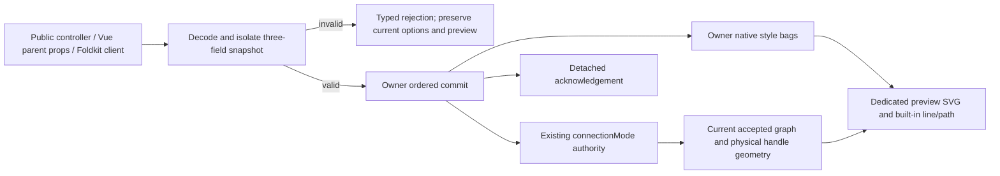

# Live connection-options design for Plan 091

2026-10-02. **PROPOSED — root and independent cold design review required before any source executor.** This document accompanies the self-contained `plans/091-replace-live-connection-options.md`. It approves no API/source, imports no 086 bytes and closes no original member. Main remains `841be137e253cf19c665269eaaa79edc19abf3c3`.

## First REVISE and bounded installed-proof correction

First plan/design hashes `834707c1ee4c83bd8323aea2f952fcf6d0871e22942a77ae2b9de6e216eb2cc5` and `ba881ae962572084cb0434c31390cca0e8c95d973edc71eb63c8fdc818de46e3` are preserved byte-identically in `plans/091-first-review-plan.md` and `plans/091-first-review-design.md`. First REVISE review SHA256 `28bab168856a6c4125668982fdc5ddc5bf7c296ebedc7ed7903ee1e9cf59c531` remains unchanged in its original path and exact copy `plans/091-first-review-verdict.md`; the manifest is `plans/091-first-review-inputs.md`. TEST-COVERAGE-091-01 correctly identified the false no-packaged-Vanilla premise. This revision fixes that premise and adds only the already-allowlisted installed Vanilla declarations/browser proof. Other API/input/domain/lifecycle/assembly contracts are unchanged and still await root plus fresh cold approval.

## Decision and exact boundary

Propose one whole replacement snapshot of `connectionMode`, `connectionLineStyle`, `connectionLineContainerStyle` on an existing owner. Unknown input is eagerly decoded and isolated at invocation before returning/queuing a public Promise and before any state/resource/render change. Construction extracts only this subset from larger existing option bags and snapshots before lazy Runtime init; unrelated constructor options retain their contracts. Mode defaults strict; absent/own undefined style bags resolve empty and clear previous caller declarations. Complete bags replace prior bags. Equal key/value snapshots, including different object/key order, acknowledge unchanged. Radius, threshold, line type, auto-pan, origins, callbacks, renderer registries, graph data and persistence remain outside the subset.

Proposed names: Vanilla `replaceConnectionOptions(unknown):Promise<FlowConnectionOptionsResult>` plus detached `getConnectionOptions()` on both public controllers; Foldkit `createConnectionOptionsClient(handle)` with replace/get/dispose and new `connectionOptionsRequests`/`connectionOptionsResults` ports on the same Runtime program; Vue existing connectionMode plus two new style props, one batched pre-render accepted snapshot, new `connectionOptionsResult` event and read-only FlowEditor/useFlow `getConnectionOptions`. These names exist only in this reviewed proposal until source implementation.

Core Schema-derived contracts are FlowConnectionStyleSchema (string keys/string values), input (three optional fields with explicitly legal own undefined), resolved snapshot (strict|loose plus two required string bags), and exact result/error schemas. Input/bags require plain records with own enumerable string data properties, rejecting DOM/class/accessor/symbol-key inputs before Struct/Record property reads. Schema decode uses excess-property error. Arbitrary decoded graph subtypes remain outside this validation entirely.

Errors are `FlowConnectionOptionsInvalid` (sanitized field/message), `FlowConnectionOptionsDisposed`, `FlowConnectionOptionsHostUnavailable`. Success results carry requestId, applied|unchanged, monotonic owner revision, detached options, cancelledPreview boolean. Rejections carry requestId, rejected, error, known revision/options or null before a client has received a delivery. Invalid-input host acknowledgement reads the actual latest configuration; locally disposed/unavailable clients return only their last delivered view and never claim it is current host authority. Revision increments once per effective replacement, never on get/equality/rejection. No function, CSSStyleDeclaration, DOM event, callback registry or JSON graph transport is introduced.

The diagram describes proposed execution, not an implemented call path. Core owns browser-free contract/normalization; applications/framework adapters own lifecycle and rendering. The selected native Graph Model's mode remains one operational authority. Foldkit style bags/revision may sit beside that field in its operational Model, with missing older operational values resolved empty/0; they are excluded from document, FlowSnapshot and saved-session projections. Do not add a second mode store, style renderer closure or generic option patcher.

## Provenance and drift evidence

Accepted source is `/Users/richardmcandrews/.codex/worktrees/typed-data-factory/flow`; external freeze is `/Users/richardmcandrews/.codex/worktrees/typed-data-factory/typed-factory-evidence/final-freeze.json`, SHA256 `2dee299d28a1b96442e3134cd4b46c380dd3dd2caeef9f28bcb46c7e96d90917`. Author independently rehashed all 1,492 complete candidate files and 122 evidence files with zero mismatches. Provenance is `f6e9a44c7a743af5e98585ecfd8f0a80ffbad1a90b5caea33cd27c3bf976820a`; execution is `8d8708faf2b6d236ee494720173988fe5ee95303150d285123002c91573b7eb7`. Main primary/cold source reviews explicitly accept this factory foundation; historical pending text in the frozen executor records is not rewritten.

Approved callback/field decomposition was read in full: primary semantic review SHA256 `e96415b6ff4901a2e6c996c326dfdc1e87c18d10cabca48c369aa6eb86caf908`, independent residual approval `0ecd9342e6523c796c782ff86a2d4f5268d2f23d630bd621a5b4cb29ec69015b`. The 091 plan number is newly reserved for this API prerequisite; the earlier null-number/null-command proposal is immutable history, not retroactive source authorization.

### [CORRECTNESS-091-01] Freeze the actual native style boundary before implementation

- Evidence: accepted087 `apps/vanilla/src/mount-flow.ts:316` has connectionMode but no style fields; Foldkit `packages/foldkit/src/application.ts:2558` captures creation options and `:152` lacks replacement; Vue `packages/vue/src/flow-canvas.ts:530`/`:1041` has reactive mode but no accepted style props. No connectionLineStyle or connectionLineContainerStyle symbol appears in these accepted host files.
- Impact: copying the moving candidate or treating accepted087 as already styled would hide an assembly/source dependency and give the executor the wrong API/default/type basis.
- Effort M/L including genuine native same-owner proof; risk HIGH because request/lifecycle/style placement crosses three adapters; confidence HIGH for the audited source inventories and declarations.
- Fix sketch: build the bounded fresh 091 capability on the exact accepted087 assembly after root+cold design approval. If native implementation requires 086 repairs, stop for an accepted086/native integration freeze plus an exact assembly amendment. Never borrow its moving bytes.

UNACCEPTED moving086 domain observations were personally read: `/Users/richardmcandrews/.codex/worktrees/native-parity-acceptance/flow/apps/vanilla/src/mount-flow.ts:347`–`:348` uses `S.Record(S.String,S.String)`; `:3383`/`:3394` applies declarations using setProperty. Foldkit `packages/foldkit/src/graph.ts:499`–`:503` and `:2943` uses readonly string bags; `application.ts:2705`–`:2734` snapshots style once into renderer closures. Vue `flow-canvas.ts:354` uses readonly CSSProperties, wider than the portable string domain, and props at `:668`/`:672` are present only in that moving source. 091 proposes fresh string bags for all three new boundaries; numeric CSS values/full CSS/native custom-content style mapping remain original 074/067 work. That deliberate common subset needs design approval and must not overwrite a later accepted broader Vue API without amendment.

Cumulative integration STOP remains: UNACCEPTED moving086 already defines `packages/core/src/domain/flow-connection-options.schema.ts:26`–`:42`, a larger contract at the same path marked NEW on accepted087. No overlay/overwrite or borrowed bytes are allowed. Accepted086/native integration plus a root+cold reviewed exact canonical-schema/domain/assembly amendment is required before cumulative integration.

Pinned source-only evidence at `research/artifacts/xyflow/0a1f9575b25679f2880175de8d3eae21aedde921/packages/react/src/types/component-props.ts:312`/`:316` declares CSSProperties and `:323` connectionMode; `container/ReactFlow/index.tsx:266`–`:268` forwards line/container style; `components/ConnectionLine/index.tsx:46`–`:53` puts container style on its own SVG and line style on its line/custom component; `:129` places style on the path. Source similarity is not a paired runtime proof. The broad React CSS domain is not implemented by 091's string-only proposal.

## Existing production call paths

Every relative native path here resolves under accepted087, never under main or moving086:

| Stage | Vanilla | Foldkit | Vue |
| --- | --- | --- | --- |
| Public input | apps/vanilla/src/public.ts:8; mount-flow.ts:9082 | packages/foldkit/src/public.ts:2; application.ts:2558 | packages/vue/src/public.ts:1; flow-canvas.ts:475, :530 |
| Current state authority | construction options consumed at mount-flow.ts:2664; document-only controllers :964/:9725 | application.ts:2573 closes graphView; graph.ts:192 connectionMode; HostAction application.ts:152 has no replacement | flow-canvas.ts:1041 computed props; new accepted options ref is a proposal replacing raw prop consumption for this subset |
| Geometry | mount-flow.ts:2247 accepted projection; :2545 handleCenterInFlow | graph.ts:2523 connectionPreviewState, :2655 current mode/geometry | flow-canvas.ts:3095 connectionPreviewState with current graph/handles |
| DOM/lifecycle | mount-flow.ts:3001 own SVG/line; :3033 append; :3092 cancelConnection; :6326 targeted connect/reconnect/click cleanup | graph.ts:3258 SVG, :3275 path; :1779 broad CancelGesture is unsafe for unrelated gestures | flow-canvas.ts:3876 existing mode watcher; :5029 path/component; :4988 unmount cleanup |
| Visible output | apps/vanilla/src/style.css:483 container / :493 line defaults | graph.ts:3281 stroke/width defaults | flow-canvas.ts:5378 shared accepted-edge SVG containing preview; new dedicated preview container is required to isolate container style |

Proposed commits keep these real geometry/resource authorities. Accepted-style configuration must not predict current handle measurements, remount the owner, reset viewport/document or turn field-type parameters into runtime properties.

## Replacement, rendering and cancellation decisions

Whole `{}` means strict and no caller declarations. Own undefined at a top-level option has the same explicit default/clear meaning; own undefined inside a bag is invalid. String `'0'` is accepted for CSS declaration values and tested on actual computed output; numeric 0, null, array, false, function or DOM/class record is rejected. Unknown top-level keys reject. Unknown CSS declarations and ignored CSS strings stay within the string domain and follow browser behavior; 091 adds no complete CSS parser.

Only a changed mode cancels an active connection preview. It invokes the host's real pointer-connect/reconnect/click/keyboard resource and terminal path, preserving the most recent accepted state before commit and independently acknowledged earlier changes. It does not globally cancel node drag/pan/resize/selection or secretly revoke an already-emitted controlled document proposal. Mixed mode/style replacement cancels first, then the next connection sees new bags. Rejected replacement leaves capture/auto-pan/preview/DOM and mode unchanged. Equality changes no resources/revision.

Style-only replacement reconciles the active built-in preview without a new connection session, resetting coordinates or connect-start/end. Remove prior caller declarations before adding new complete bags; empty bags restore native defaults. Container style affects only the dedicated preview SVG, never Vue's shared accepted-edge SVG. Line style affects only the built-in preview line/path. No callback/registry type or identity is widened; arbitrary custom renderer line styling/context remains 067/074 open. Reconcile visual style without sending an identical semantic preview to unrelated subscribers. An existing renderer throw uses its existing failure boundary and is not misclassified as input rejection/transactional rollback.

Native acknowledgement covers the committed options/render scheduling turn, not browser paint. Public browser tests separately await actual DOM/physical handles. Style-only behavior refines the earlier unnumbered generic cancellation proposal and must be explicitly approved; it does not revise historical matrices or close their cells.

## Foldkit request and lifetime boundary

The new adapter request Schema union is replace(normalized snapshot), get, or reject(sanitized decoder error), each with unique client namespace/counter requestId. The host processes requests in order and emits the exact current revision/options; invalid caller input is not sent raw to ports. Direct malformed raw port input produces the actual Foldkit SchemaError Exit without a graph transition/result. Shared-port listener matching uses full client IDs, allowing two independent clients on one Runtime. Public client decoding and the library's port transport validation are distinct boundaries; no graph data codec participates.

The installed dependency at the accepted root was personally read. `node_modules/foldkit/dist/runtime/hostConnector.d.ts:41` exposes only ports and dispose, with no disposal subscription. `hostConnector.js:9`–`:10` returns Exit.void after disposal; `:71`–`:75` clears pending inbound/listeners. Therefore a successful send does not prove host liveness and cannot detect disposal.

ConnectionOptionsClient.dispose synchronously settles its own pending calls, unsubscribes and ignores its own late responses, without disposing or changing the Runtime/another client. Application composition closes every owned auxiliary client before the same Runtime.dispose; fixtures and docs must demonstrate this explicit order. One client close on a live Runtime leaves the other able to replace options/connect. Direct raw Runtime disposal bypassing auxiliary closes is an acknowledged unverified pending-request gap; no fake event, polling timeout or automatic-settlement claim is allowed. If automatic detection becomes necessary, design a separately reviewed real owner hook before source work.

Vanilla destroy owns its request/resource teardown. Vue unmount stops prop processing/native resources and does not promise acknowledgement for a prop batch abandoned at unmount; it has no imperative replacement Promise. All native requests/readbacks/results are detached; owner IDs and same graph IDs remain scoped. No serializable port contains DOM/native renderer functions.

## Exact proof and verification boundary

Production tests differ from the source/reference path. NEW public fixture triples are `apps/{vanilla,vue,foldkit}/src/live-connection-options-test.ts`, matching HTML entry and `e2e/live-connection-options.e2e.ts`; the plan enumerates the nine literal paths individually. Vanilla calls `/src/public.ts`; Vue actual parent props use `@flow/vue`; Foldkit uses package-public createProgram, actual Runtime.embed and the new auxiliary client over actual ports. Same controller/UID/EmbedHandle is recorded across changes; remount/new host/input mutation is never replacement proof.

Owned core and host units cover actual public decoder/result/transition operations. Existing application/client tests are examples, not evidence that the new contract already exists. New common `tests/consumer/live-connection-options.runtime.ts` and `.types.ts` run and compile against all three real packed archive consumers and prove the common @flow/core boundary. All three adapter archive declaration surfaces require their own actual-package assertions; preserve every existing assertion and compiler policy.

Vanilla is packaged as `@flow/vanilla` by accepted `apps/vanilla/package.json:2`, `:12`–`:20`, with built public.js/public.d.ts exports. `apps/vanilla/src/public.ts:1`–`:9`, `:38`–`:56` exports mountFlow/createFlow and both controller types. The existing runner packs/selects that package at `scripts/check-packed-consumer.ts:653`–`:675` and installs/compiles/verifies its browser at `:774`–`:813`. Add exact `@flow/vanilla` imports in the already-allowlisted `tests/consumer/consumer.typecheck.ts` for BOTH FlowController and JavaScriptFlowController: unknown input parameter equality, exact Promise of authoritative Schema-derived replacement result, and exact Schema snapshot readback. Unknown malformed values are legal call arguments; result/signature incompatibility negatives are separate from runtime rejection cases.

For runtime proof, the protected installed fixture `tests/consumer/main.ts:19`–`:44` imports the actual archive and exposes its real controller as `window.__flowConsumerController`. Add a named helper to the already-allowlisted `scripts/check-packed-consumer.ts` verifyVanilla path before its existing destruction at `:223`. Extend the runner-local Window type with actual public method types, without altering the fixture. The helper uses that exact archived controller for replacement/get/default-clear/equality and revision/typed atomic rejection/healthy recovery/detached readback and results, preserving the same controller and accepted document. Restore strict/empty options before the unchanged destruction/assertion sequence. Existing main.ts and every old assertion remain byte-identical; inability to use its current exposure is a STOP for a separately reviewed fixture amendment.

The three new local public-entry suites still separately prove active preview/style/capture/gesture/current physical geometry and same-owner lifecycle. Installed core probes, archived Vanilla API proof and local native gesture proof are distinct required claims. The done boundary includes actual both-controller archive type cases and a named runner assertion map, not merely successful core import/typecheck or a local Vanilla mount.

Required meaningful cases: strict→loose→strict on one owner; active style add/change/clear and explicit top-level undefined; numeric zero rejection versus string zero output; atomic mixed-invalid rejection plus healthy recovery; every actually supported connection-mode cancellation path using latest accepted baseline; unrelated live gesture preserved; equality/back-to-back/reentrant request order; caller/result isolation; two independent same-ID owners; two clients on one Runtime with one close; explicit all-client-before-Runtime close order; existing literal/versioned persistence outputs excluding options; installed positive/negative public contract cases, both exact archived Vanilla controller signatures and the existing archived controller runtime exercise before unchanged destruction. Typed data/generic member contracts are not patched or proved here.

The saved focused scope is exactly docs/contracts/api-members/traces/consumer, plus each host's new live-connection-options, existing interaction-lifecycle, renderer-contract and versioned-persistence browser suites. Baseline quality/architecture/package builds/types/all units remain required. Actual commands are `bun run test <four owned test paths>`, `bun run verify --list`, then `bun run verify`; expected exit 0 without new skips/policy changes. `bun run verify:full` remains required later at integration/release/broad claims. The author ran none of these. Exact source/test/protected allowlists and execution steps are fully inlined in Plan 091, not inferred from this paragraph's path shorthand.

Formal source review allows at most two corrective revisions after initial review. Mechanical gate diagnosis/formatting within scope has no arbitrary attempt-count limit. Unresolved semantic/out-of-scope defects stop acceptance and require a scoped amendment; no blind retries, tolerance/timeout/skip relaxation, self-acceptance, undocumented path expansion or dependent dispatch. Root and fresh cold design approval precede any executor.

## Alternatives and reasons

Keep constructor/remount behavior alone: low source risk but cannot preserve same owner/state and leaves the requested live boundary missing. Add a universal option patcher: increases every neighboring owner/codec/callback ambiguity and is outside the selected subset. Proposed three-field whole replacement makes defaults/clearing/atomicity reviewable while native methods, actual Vue props and Foldkit ports keep their established owner shape. Keep Vue full CSSProperties immediately: would require a reviewed exact native decoder/domain beyond this string contract or an accepted086 dependency; leave it for 074 rather than inventing a CSS validator. Add a client that destroys Runtime: rejected because auxiliary viewport/snapshot/registration client semantics and application composition own host teardown.

## Audit limitations

Read required improve skill/template/audit sections, standards, full final matrix approvals, exact 087 source acceptance/provenance and live source/dependency declarations. Validated the complete accepted source/evidence inventories without running tests. Moving086 hashes below are dated read-only observations, not an immutable source acceptance. No install/build/compiler/product probe/gate/browser/port/executor/agent ran. Full CSS, custom renderer presentation, native restoration/HMR, exact pinned execution, typed actor/native adaptation, original member closure, integration/full/CI/device/collector proof remain unverified.

## Personally read source byte identities

The first thirteen rows are selected accepted087 source/contract/tooling. Installed dependency rows are read-only local dependency evidence and are not copied as product source.

| Selected-root path | SHA256 |
| --- | --- |
| apps/vanilla/src/mount-flow.ts | `146e153465abf0c113cfd2458d9c559e3de701b4800eba5c25ddbfbe7082434e` |
| apps/vanilla/src/public.ts | `dd8a493159be3b0ab5b6559aaddd8845333052270d01b786147481c2d7c4cc79` |
| packages/vue/src/flow-canvas.ts | `611c202d65f81340790f047c421b5e612791aa035a993df5e5fc1b1a26a01350` |
| packages/vue/src/use-flow.ts | `abf4c45476d3dceb659035bf06ae29b1d04390a9ba32c715b74454058e90c2dc` |
| packages/vue/src/public.ts | `6886fa15a85b35da1d9c85fd36582349f3772633ed94a245c93140724cf33a4d` |
| packages/foldkit/src/application.ts | `09041a59a48e0f6c3e4dbaa97a86320083a5e3af3c312a5c8bae5efd2af6cdb7` |
| packages/foldkit/src/graph.ts | `3cbcb104203db2385b193fc16ff02c1a0faadf5d8942c082cfd69d1ddf92b100` |
| packages/foldkit/src/public.ts | `f9835e72fad88d40d6469938f0a32fea48d478dcc546f8fce2808a42ebeed925` |
| packages/core/src/domain/flow-connection.schema.ts | `ef17a3ac5902a385739a3292beda3724aa7c5c1c815f461dd77520c3080585d9` |
| packages/core/src/public.ts | `3ebe97996606ee5056dfa5db6e104a704ec2d1121e9cfefdb8be0ab7fecb29a3` |
| packages/core/src/telemetry/flow-telemetry.ts | `ec7b617a412ebab74a6a52590161bebe8087ae868e272e3a5357f52f7f3e432d` |
| scripts/check-packed-consumer.ts | `1d43b65b88b69f5b5d971a19745679aac9c82fe87080cf363a0d324b17161fe6` |
| verification.config.json | `11ec11c3969df7d24ae3d5ff38432477e1e1e7c539c99a4feecd83714e1e1a08` |
| node_modules/foldkit/dist/runtime/hostConnector.d.ts | `9634e8df602ab4d0956793691e58a200070d1c3848bd34cbda591154d47f3527` |
| node_modules/foldkit/dist/runtime/hostConnector.js | `2b3bc50c8c7754fd3c018c73cc26782f2db8225697f4164db9783ae5bda3a328` |

Additional personally read accepted087 installed Vanilla boundary bytes:

| Selected-root path | SHA256 |
| --- | --- |
| apps/vanilla/package.json | `ec1baa252ab7229026ebaf1727b50f9bc6ca2f4cdc8c805def1bac99148fa18f` |
| tests/consumer/consumer.typecheck.ts | `dda70e8f1e2b16e252a60fc638f9001c1847afdc7440cf4df5e62d1c83200d9b` |
| tests/consumer/main.ts | `551ab97b8bc452dc76c3d354be421efe18bd59aecdc5c8d1fb96eb4a5d0ef232` |

UNACCEPTED moving086 reads, 2026-10-02; these hashes freeze only the observed declaration bytes for review and confer no import permission.

| Moving-root path | Observed SHA256 |
| --- | --- |
| apps/vanilla/src/mount-flow.ts | `17bf3a5b5fa4d464766bd6c80ea5cce22a3ed100408838af1816d431403604a3` |
| packages/vue/src/flow-canvas.ts | `b83469953b2bf3d6874528cd9aacd7eddc122abfd19158db610be9a4981580e5` |
| packages/foldkit/src/application.ts | `a2300ae9dee80fd10a518d49e3c285c080ce74033ef14b645c87337d9978805f` |
| packages/foldkit/src/graph.ts | `5fb02b9bbb802f9b3626f8e20b00d41553c3987b3a57278970801a8e15cfcf8d` |

## Conformity and deviations

Conforming target: Schema-owned unknown/config/result/error boundaries, one operational mode authority, current accepted graph geometry, whole style replacement with real DOM cleanup, operation-specific preview cancellation and isolated native lifecycles. Pinned CSSProperties is wider than the new common string domain; the native acknowledgement and explicit Foldkit auxiliary-client close order are bounded adaptations requiring named future source/browser/installed tests. Direct raw Runtime disposal and custom/full-CSS outcomes remain acknowledged gaps. All original 067/071/072/074 cells remain OPEN; no source permission or product parity follows before root+cold approval and actual execution evidence.
